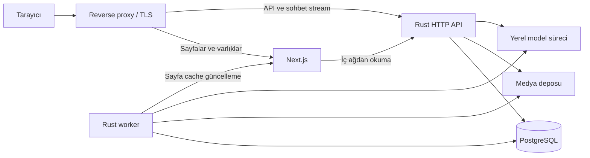

# Kişisel Web Sitesi — Teknik Mimari ve Geliştirme Planı

Sürüm: 0.1 — önerilen mimari temel  
Tarih: 26 Ekim 2026  
Durum: Teknik tasarım; uygulama geliştirmeye geçilmedi.

Bu belge, Rust backend ve önerilen Next.js frontend için uygulanabilir mimari sınırları, veri akışlarını, güvenilirlik kurallarını ve geliştirme sırasını tanımlar. Kullanıcı .NET mimarisinde deneyimli; bu çalışma ilk Rust projesi olacak ve AI destekli geliştirme yöntemiyle ilerleyecek.

İlgili belgeler:

- [PROJE_KAPSAMI.md](PROJE_KAPSAMI.md): ürünün amacı ve işlevleri.
- [TASARIM.md](TASARIM.md): görsel yön, hareket tasarımı ve onay durumları.
- [Görsel referanslar](referanslar/tasarim/): üretilmiş dört statik taslak.

Bu belgedeki klasör ağacı, veri modeli ve endpoint adları tasarım önerisidir; bu dosyalar veya uygulama bileşenleri henüz oluşturulmadı.

## İçindekiler

1. Karar durumu ve varsayımlar
2. Mimari hedefler ve IM2026'dan alınan ilkeler
3. Önerilen teknoloji temeli
4. Çalışma zamanı topolojisi
5. Rust workspace ve bağımlılık sınırları
6. Özellik modülleri ve veri sahipliği
7. Domain, kullanım senaryoları ve Rust yaklaşımı
8. Kalıcı veri ve revision modeli
9. Transaction ve eşzamanlılık
10. Outbox, işler ve projection'lar
11. İçerik yayımlama ve geri çekme akışları
12. Medya yaşam döngüsü
13. Arama mimarisi
14. Yapay zekâ asistanı
15. HTTP ve streaming sözleşmesi
16. Kimlik ve erişim modeli
17. Next.js ve frontend mimarisi
18. Hareket ve performans yaklaşımı
19. Cache ve tutarlılık
20. Gözlemlenebilirlik ve yapılandırma
21. Test ve CI kalite kapıları
22. Dağıtım, migration ve kurtarma
23. AI destekli geliştirme kuralları
24. Uygulama fazları
25. Açık kararlar ve riskler
26. Kabul ölçütleri ve teknik kaynaklar

## 1. Karar durumu ve varsayımlar

| Konu | Durum | Açıklama |
| --- | --- | --- |
| Backend dili | Kullanıcı kararı | Rust. |
| Çalışma ortamı | Kullanıcı kararı | Kullanıcının kendi sunucusunda canlı çalışma. OS ve donanım henüz bilinmiyor. |
| Geliştirme yöntemi | Kullanıcı kararı | AI destekli geliştirme; mimari ve kalite seviyesi IM2026 deneyiminin devamı olacak. |
| Mimari biçim | Önerilen başlangıç | Özellik modülleri bulunan modüler monolit; derleme düzeyinde katman sınırları. |
| HTTP altyapısı | Önerilen başlangıç | Axum, Tokio ve Tower. |
| Veri katmanı | Önerilen başlangıç | PostgreSQL ve SQLx; açık SQL ve transaction sınırları. |
| Frontend | Önerilen başlangıç | Next.js App Router, React ve TypeScript. |
| API sözleşmesi | Önerilen başlangıç | Rust'tan OpenAPI üretimi ve bundan türetilen TypeScript istemcisi. Utoipa aday araç. |
| Animasyon | Aday | GSAP; portre akışının Canvas/WebGL/render yöntemi performans denemesiyle seçilecek. |
| AI çalıştırma | Hedef | Sunucuda ayrı model süreci; model, runtime ve kaynak ihtiyacı henüz seçilmedi. |
| İçerik girişi | Açık | Yönetim paneli, dosya/import veya başka bir editörlük akışı henüz seçilmedi. |
| Kalıcı sohbet geçmişi | Açık; başlangıç varsayımı kapalı | Anonim ziyaretçi deneyimi için varsayılan olarak kalıcı konuşma kaydı tutulması planlanmıyor. |
| Çok dilli içerik | Kararlaştırılmadı | Çok dilli selamlaşma, çok dilli içerik yönetimi gereksinimi oluşturmaz. |

Doküman hazırlama talebi, tabloda öneri veya açık olarak işaretlenen her ayrıntının ayrı ayrı onaylandığı anlamına gelmez. Uygulama öncesinde kritik açık kararlar kapatılacak.

## 2. Mimari hedefler ve IM2026'dan alınan ilkeler

Hedef, yeni özellikler eklenirken kuralları ve veri tutarlılığı korunabilen, hatası izlenebilen ve yeniden başlatıldığında toparlanabilen bir sistemdir.

IM2026 incelemesinden korunacak ilkeler:

- Domain nesneleri durum değişimlerini ve iş kurallarını korur.
- HTTP, iş senaryosu ve dış sistem adapter'larının sorumlulukları ayrılır.
- İş verisi, audit ve outbox gerektiğinde aynı transaction'a katılır.
- Sürüm kontrolü ve veritabanı constraint'leri birlikte kullanılır.
- Dosya sistemi ile veritabanı arasındaki işlemler telafi ve temizlikle yönetilir.
- API hata sözleşmesi, frontend tipleri ve oturum davranışı birlikte ele alınır.
- Mimari bağımlılıklar, kritik iş kuralları ve kurtarma yolları otomatik doğrulanır.
- Yedekleme ve geri yükleme, dağıtımın parçasıdır.

Yeni projede güçlendirilecek alanlar:

- Özelliklerin açık veri sahipliği ve dar kullanım senaryosu sözleşmeleri.
- Dış ağ işlemlerini uzun DB transaction'larından ayıran kalıcı iş altyapısı.
- İçerik revision'ı, indeks ve AI bağlamı arasında izlenebilirlik.
- İlk günden çalışan CI ve API sözleşmesi sapma kontrolü.
- Rust'ın tip sistemi ve ownership modeline uygun somut uygulama biçimi.

### 2.1 Mimari değişmezler

| Kimlik | Değişmez |
| --- | --- |
| M-01 | Kalıcı içerik ve yayın kararının otoritesi Rust backend'dir. |
| M-02 | Domain HTTP, SQLx, dosya sistemi ve model servisinden bağımsızdır. |
| M-03 | Bir kullanım senaryosunun transaction'ının tek sahibi vardır; alt repository kendi başına commit etmez. |
| M-04 | Yayın durumu/revision değişikliği ile buna bağlı outbox kayıtları birlikte commit veya rollback olur. |
| M-05 | Model, embedding ve dış ağ çağrıları açık DB transaction'ı içinde yürütülmez. |
| M-06 | Arama ve AI projection'ları yeniden üretilebilir; ana içerik kaynağı yerine geçmez. |
| M-07 | Eski iş veya olay, monoton yayın sürümüne göre daha yeni yayın/güncelleme/geri çekme kararını tersine çeviremez. |
| M-08 | Yeni anonim API ve retrieval istekleri güncel yayın görünürlüğünü kontrol eder. |
| M-09 | İşler en az bir kez işlenebilir; tüketiciler tekrar çalışmaya dayanıklı tasarlanır. |
| M-10 | Kullanıcı oturumu ve özel veriler Next sunucusunda global modül belleğinde tutulmaz. |
| M-11 | AI ve animasyon arızası temel içerik gezinmesini bozmaz. |
| M-12 | Süre, çıktı, kuyruk ve eşzamanlılık limitleri yapılandırılabilir ve ölçülebilir olur. |

M-08, daha önce tarayıcıya gönderilmiş içeriğin geri alınabileceği veya başlamış bir stream'den hiçbir bilginin çıkmayacağı garantisi değildir. Bu sınırlar 11, 14 ve 19. bölümlerde açıklanır.

## 3. Önerilen teknoloji temeli

| Alan | Öneri | Gerekçe ve sınır |
| --- | --- | --- |
| HTTP | Axum | Route, extractor ve response modelini transport katmanında tutmak. |
| Asenkron çalışma | Tokio | HTTP ve I/O eşzamanlılığı; CPU yoğun modeli aynı işleyicide çalıştırmamak. |
| Middleware | Tower / tower-http | Süre sınırları, izleme ve HTTP ortak davranışları. |
| Kalıcı veri | PostgreSQL | İçerik, sürüm kontrolü, kalıcı işler ve başlangıç metin araması için ortak ilişkisel temel. |
| Veri erişimi | SQLx | Açık sorgular, transaction ve migration; EF change tracker varsayımı taşımamak. |
| API şeması | OpenAPI, Utoipa adayı | Path, istek, yanıt ve hata tiplerinin tek sözleşmeden üretilmesi. |
| Frontend | Next.js / React / TypeScript | Halka açık sayfaları hazırlama, metadata ve etkileşimli alanları birleştirme. |
| Hareket | GSAP adayı | Çok dilli giriş ve zaman çizelgesi tabanlı geçişler. |
| Semantik arama | Gerektiğinde pgvector adayı | Aynı DB'de vektör araması; önce içerik miktarı ve Türkçe kalite ölçülür. |
| Model | Ayrı yerel model runtime'ı | Dil modeli erişimi değiştirilebilir adapter arkasında; donanım görülmeden model seçilmez. |

Bu tercihler resmî [Axum](https://docs.rs/axum/latest/axum/), [SQLx](https://github.com/transact-rs/sqlx), [Next.js](https://nextjs.org/docs/app/getting-started/server-and-client-components), [GSAP React](https://gsap.com/resources/React/) ve [pgvector](https://github.com/pgvector/pgvector) kaynaklarıyla uyumlu bir başlangıç önerisidir. Mimari düzen bu projenin tasarım kararıdır; kütüphanelerin dayattığı bir şablon değildir.

İlk sürüm için dağıtık broker, ayrı arama kümesi ve dağıtık cache gereksinimi belirlenmedi. Bunlar ölçülen bir ihtiyaç ve gerekçeli karar kaydıyla eklenebilir. Paket sürümleri uygulama başlangıcında uyumlulukları doğrulanarak kilitlenecek; bu belgede güncel sürüm numarası sabitlenmiyor.

## 4. Çalışma zamanı topolojisi



- Ana site ve `/api/*` aynı origin altında sunulur.
- Sayfalar Next'e, API istekleri Rust'a yönlendirilir.
- Next sunucu bileşenleri Rust'ın iç adresinden doğrudan veri alır; sırf geçiş için ikinci bir Next API zinciri eklenmez.
- Rust API ve worker aynı kaynak kodunu, iş modüllerini ve sürümü paylaşır. Ayrı süreç çalışmaları kaynak ve hata izolasyonu içindir.
- PostgreSQL ve model servisi için doğrudan kamusal erişim gerekmez.
- Model kullanılamadığında arama ve proje sayfaları çalışmaya devam eder; sohbet açık bir durum mesajı verir.
- Sunucu OS, servis yöneticisi, proxy ürünü ve paketleme şekli ortam bilgisine göre seçilecek. Linux, Docker veya GPU varsayılmıyor.

Next'in kendi sunucusunda çalıştırılması ve reverse proxy yaklaşımı için [resmî self-hosting rehberi](https://nextjs.org/docs/app/guides/self-hosting) esas alınacak.

## 5. Rust workspace ve bağımlılık sınırları

### 5.1 Önerilen başlangıç düzeni

Beş crate, katman sınırlarını Cargo bağımlılık grafiğinde görünür kılar. Özelliklerin her katmanı için ayrı crate açılmaz.

```text
backend/
  Cargo.toml                     workspace tanımı
  crates/
    portfolio-domain/            kurallar, değer tipleri, domain hataları
    portfolio-application/       kullanım senaryoları ve dış sistem portları
    portfolio-infrastructure/    DB, medya, model, işler ve diğer adapter'lar
    portfolio-http/              HTTP/stream transport ve DTO eşlemeleri
    portfolio-host/              api ve worker giriş noktaları, composition
      tests/                     süreçler arası entegrasyon doğrulamaları
  migrations/                    sıralı DB değişiklikleri
frontend/                        Next uygulaması ve üretilen API istemcisi
```

Bu bir öneri ağacıdır; klasörler şu an oluşturulmuş değildir. Birim testleri ilgili modüllerde, entegrasyon testleri ilgili crate'in `tests/` dizininde tutulur. Yalnız workspace manifest'i içeren kökteki bir `tests/` klasörünün Cargo tarafından kendiliğinden çalıştırılacağı varsayılmaz. Workspace'in ortak kilit ve paket düzeni [Rust'ın resmî workspace yaklaşımına](https://doc.rust-lang.org/book/ch14-03-cargo-workspaces.html) dayanır.

### 5.2 İzin verilen proje bağımlılıkları

| Crate | İzin verilen proje bağımlılığı | Yasak sorumluluk |
| --- | --- | --- |
| Domain | Yok | HTTP, DB, I/O, kendiliğinden saat okuma. |
| Application | Domain | Axum/SQLx tipleri, somut model veya storage sağlayıcısı. |
| Infrastructure | Application, Domain | Yayınlama gibi iş kurallarının ikinci uygulamasını oluşturmak. |
| HTTP | Application | Somut DB/model adapter'ını çağırmak, iş kuralı kararı vermek. |
| Host | Application, Infrastructure, HTTP | Route veya iş senaryosu mantığını üstlenmek. |

Domain için I/O yapmayan temel değer/zaman yardımcıları gerekebilir; izin verilen bağımlılıklar açık bir listeyle tutulur. Amaç her yardımcı değeri sıfırdan yazmak değildir.

### 5.3 Özellik sınırının güvencesi

Application ve Domain içinde `content`, `search`, `assistant`, `media` gibi özellik modülleri bulunur. Alt uygulama ayrıntıları private kalır; yalnız seçilmiş facade, sözleşme ve operasyonlar dışarı açılır.

Katman bağımlılığı Cargo ile; aynı crate içindeki modül erişimleri Rust görünürlüğü ve mimari kontrollerle korunur. Aynı crate içindeki her iş modülü kuralının otomatik olarak ayrı crate kadar sert olduğu varsayılmaz. Geniş `pub(crate)` ve ortak mutable servis torbaları sınırı zayıflatır.

Bir özellik bağımsız bağımlılık yönetimi, daha sıkı derleme sınırı veya ayrı yaşam döngüsü gerektirdiğinde kendi crate'ine çıkarılır. Bu çıkarma, yeni mikroservis veya yeni veritabanı gerektirmez.

## 6. Özellik modülleri ve veri sahipliği

| Modül | Sahip olduğu davranış/veri | Dışarı açtığı işlemler |
| --- | --- | --- |
| Content | Tanıtım ve proje içeriği, yayın durumu, slug, revision, sıralama ve etiket ilişkileri. | Yayımlanmış içeriği okuma; içerik oluşturma/güncelleme/yayımlama/geri çekme kullanım senaryoları. |
| Media | Medya metadatası, geçici/aktif/silme bekleyen yaşam döngüsü ve depolama referansı. | Yükleme, doğrulama, kullanılabilir medyayı sorgulama ve silme talebi. |
| Search | Metin indeksi, arama sorgusu, sıralama, indeksleme durumu; gerekirse chunk/embedding projection'ı. | Arama ve asistan için kaynak bulma. |
| Assistant | Soru işleme, bağlam seçimi, kaynak eşleme, model çağrısı ve yanıt akışı. | Mesaj üretimi, iptal, kullanılabilirlik ve sınırlandırılmış öneri sorular. |
| Administration / Identity | Gerekirse editörlük erişimi, yönetici oturumu ve yönetim işlemlerine yetki. | Aynı Content/Media kullanım senaryolarına yetkili erişim. Ayrı yayın mantığı oluşturmaz. |

Kurallar:

- Bir modül diğerinin iç tablosuna erişerek iş kuralını aşmaz.
- Search, yayımlanmış içerik snapshot'ını dar bir okuma sözleşmesiyle alır.
- Assistant, Search'ün kaynak bulma sözleşmesinden yararlanır; görünürlüğü Content otoritesine göre doğrular.
- Kimlik, token ve model sağlayıcısı domain nesnesinin parçası yapılmaz.
- Ortak altyapı kodu DB havuzu veya telemetry gibi teknik konuları paylaşabilir; modüller ortak bir sınırsız repository yüzeyi paylaşmaz.
- Blog, ziyaretçi hesabı ve yönetim panelinin kapsama alınması ayrı ürün kararı gerektirir.

## 7. Domain, kullanım senaryoları ve Rust yaklaşımı

### 7.1 Domain

- Durumlar enum ve özel alanlarla temsil edilir; değişiklikler anlamlı operasyonlardan geçer.
- `ContentId`, `ContentRevisionId`, `MediaId` ve `JobId` birbirine karıştırılamayan değer tipleridir.
- HTTP biçimleri, SQL satırları ve serileştirme DTO'ları domain'den ayrı tutulur.
- Domain zamanı parametre olarak alır; uygulama katmanında değiştirilebilir saat kaynağı bulunur.
- Dilin doğal `Result` ve hata enum'ları kullanılır; C# `IsSuccess/Value/Error` nesne biçimi otomatik kopyalanmaz.
- Her modüle yapay bir aggregate eklenmez. Search sıralaması veya Assistant akışının bir kısmı application davranışı olarak kalabilir.

### 7.2 Kullanım senaryoları

Command örnekleri: taslağı güncelle, içeriği yayımla, yayından kaldır, medya ilişkilendir. Query örnekleri: proje listesi, proje ayrıntısı, arama ve yayımlanmış kaynak snapshot'ı.

Her kullanım senaryosu kendi giriş, çıktı, yetki, doğrulama, hata ve transaction sınırını tanımlar. Okuma projeksiyonları için aggregate'ın tamamını yüklemek gerekmez. Command/query ayrımı ayrı veri tabanı veya broker gerektirmez.

### 7.3 Port ve bağımlılık seçimi

- Repository, model gateway, storage ve saat gibi değişen sınırlar için trait kullanılır.
- `object id`, genel expression tree ve tüm entity'lere aynı CRUD yeteneği sunan evrensel repository başlangıç kalıbı olmaz.
- Somut adapter'lar Host'ta birleştirilir; kullanım senaryosu global service locator üzerinden çözülmez.
- Async trait için static dispatch, enum dispatch veya object-safe sınır seçimi ilk dikey dilimde doğrulanır. Native async trait'in doğrudan her `dyn Trait` kullanımına uygun olduğu varsayılmaz.
- `Send`, `Sync`, clone ve referans sayımı ihtiyaç duyulan sınırlarda kullanılır; ownership hatasını gizlemek için gelişigüzel eklenmez.
- Beklenebilir iş/altyapı hataları tipli sonuç olur. İstek yolunda `unwrap/expect` ile normal hata akışı kurulmaz.

## 8. Kalıcı veri ve revision modeli

Aşağıdaki tablo kavramsal modeldir; kesin kolon/migration tasarımı değildir.

| Kayıt | Amaç |
| --- | --- |
| İçerik kimliği | İçerik türü, slug, durum, düzenleme sürümü, monoton yayın sürümü ve güncel yayımlanmış revision referansı. |
| İçerik revision'ı | Değişmez içerik snapshot'ı, metadata, checksum, dil ve oluşturulma bilgisi. |
| Proje ayrıntıları/etiketler | Projeye özgü alanlar; revision davranışıyla tutarlı model. Bütün içerik türleri tek JSON şemasına zorlanmaz. |
| Medya | Depolama anahtarı, tür/boyut/checksum, yaşam döngüsü ve kullanım ilişkileri. |
| Arama dokümanı | Kaynak içerik + revision + aranabilir alanların yeniden üretilebilir projection'ı. |
| Bilgi parçaları/embedding | Gerekirse chunk kimliği, kaynak revision, embedding model/sürüm/dimension bilgisi. |
| Outbox olayı | Event kimliği, tür/şema sürümü, içerik kimliği, monoton yayın sürümü, kaynak revision, correlation kimliği ve payload. |
| İş/teslimat kaydı | Consumer, durum, deneme sayısı, sonraki deneme, lease/claim ve sonuç. |
| Audit | Aktör, işlem, hedef, zaman ve gerekli değişiklik metadatası. Ham sohbet veya gizli değer içermez. |

`writeVersion`, eşzamanlı düzenleme kontrolü içindir. `publishedRevisionId`, ziyaretçiye sunulan değişmez içeriği gösterir. Taslağın güncellenmesi mevcut yayını kendiliğinden değiştirmez.

`publicationVersion`, her yayımlama, yayımlanmış revision değiştirme, yayından kaldırma ve silme/görünürlük değişiminde içerik bazında monoton artar. Aynı revision'ın yeniden yayımlanması da yeni yayın sürümü üretir. Revision kimliği sıralama amacıyla kullanılmaz. İlk şemada ayrı alan önerilir; `writeVersion` ile birleştirilecekse bütün ilgili geçişlerde artışı ayrıca garanti edilmelidir.

Slug benzersizliği, zorunlu ilişkiler ve uygun durum/boyut kontrolleri DB constraint'leriyle desteklenir. Zamanlar UTC saklanır; görüntüleme bölgesi sunum katmanında uygulanır. Uzun sayısal sürümler API'de JavaScript sayı hassasiyetine bırakılmaz; opak string olarak taşınabilir.

## 9. Transaction ve eşzamanlılık

### 9.1 İşlem sahipliği

Logical transaction sınırını Application kullanım senaryosu belirler. Somut SQLx transaction'ı Infrastructure adapter'ında taşınır; SQLx tipleri Application sözleşmesine sızmaz.

Önerilen model, kullanım senaryosunun sahip olduğu bir yazma session'ıdır:

1. Gerekli kısa DB işlemi açılır.
2. İlgili kayıtlar aynı session üzerinden okunur; domain operasyonları çalıştırılır.
3. Güncelleme, audit ve gerekli outbox/teslimat kayıtları aynı session'da yazılır.
4. Başarıda açık commit; beklenen hata veya iptalde açık rollback uygulanır.

Alt repository commit etmez. Aynı transaction üzerinde bağımsız paralel mutable repository çağrıları planlanmaz. Commit/rollback session'ı kapatır. Drop yolundaki geri alma son savunmadır; normal kontrol akışı yerine kullanılmaz. [SQLx transaction davranışı](https://docs.rs/sqlx/latest/sqlx/struct.Transaction.html)

Commit çağrısının hata dönmesi her zaman rollback olduğu anlamına gelmez; DB commit olmuşken bağlantı yanıtı kaybolmuş olabilir. Yazma operasyonu için correlation kimliğinden ayrı bir operasyon/idempotency kimliği ve istek özeti tutulur; sonuç kaydı ilgili transaction'a katılır. Belirsiz durumda yeni bağlantıyla otoritatif DB'den sonuç uzlaştırılır. Aynı anahtar ve aynı istek önceki sonucu döndürebilir; farklı istek aynı anahtarı kullanırsa conflict olur. DB'ye ulaşılamıyorsa sonuç belirsiz olarak bildirilir; dosya silme veya kör mutation tekrarı yapılmaz.

Rust lifetime/async sınırları ilk çalışan kullanım senaryosunda doğrulanır. Basit bir atomic yazma için session soyutlaması gereksiz karmaşıklık doğurursa, aynı garantiyi veren kullanım senaryosuna özgü atomik persistence operasyonu seçilebilir; iki ayrı transaction modeli karıştırılmadan karar kaydı güncellenir.

### 9.2 Eşzamanlı yazma

- Güncelleme beklenen `writeVersion` ile yapılır; eşleşmeyen sürüm açık conflict üretir.
- Etkilenen satır sayısı kontrol edilir; sessiz son yazan kazanır davranışı uygulanmaz.
- Default izolasyon kısa işlemler için yeterli seviyede tutulur; çok kayıtlı invariant gerektiğinde daha güçlü izolasyon veya hedefli kilit gerekçelendirilir.
- Serialization/deadlock tekrarında kullanım senaryosu güncel veriyle tamamen yeniden çalıştırılır; deneme sayısı sınırlıdır.
- Tekrar edilen işlem içinde model/depolama/ağ yan etkisi bulunmaz.
- Operasyon/idempotency kimliği ve `(eventId, consumer)` gibi birleşimler DB benzersizliğiyle desteklenir. Revision başına artifact tekilliği, aynı revision'ın yeniden yayımlanmasını engelleyen olay tekilliğiyle karıştırılmaz.

## 10. Outbox, işler ve projection'lar

### 10.1 Kalıcı teslimat modeli

Bir yayın olayı birden fazla tüketiciye gidebilir: metin indeksi, embedding ve Next cache güncellemesi. Tek bir `processed=true` alanıyla bütün tüketicilerin başarılı sayılması uygun değildir.

Önerilen başlangıç: olay ve tüketiciye özel teslimat/iş durumu ayrı tutulsun. `(eventId, consumer)` benzersiz olsun. Olayın kalıcı kaydı ile etkin tüketiciler için teslimatlar aynı transaction'da oluşturulsun. Yeni bir tüketicinin geçmişi işlemesi gerekirse ayrıca checkpoint'li replay/backfill akışı tanımlansın. Olay; revision kimliğine ek olarak monoton `publicationVersion` taşısın.

### 10.2 Claim, lease ve sonuç kaydı

1. Worker kısa transaction'da uygun işleri seçer ve sahiplenir.
2. Claim token, worker kimliği ve lease bitişi kaydedilir; transaction kapanır.
3. İndeksleme/model/depolama işlemi transaction dışında yapılır.
4. Sonuç, yalnız hâlâ geçerli claim token'ına sahip worker tarafından kısa transaction ile kaydedilir.

Kuyruk benzeri tabloda `SKIP LOCKED` bir adaydır; genel iş sorgularında tutarlı okuma yerine kullanılmaz. [PostgreSQL kilitleme açıklaması](https://www.postgresql.org/docs/current/sql-select.html)

Uzun işlerde lease yenileme ve sahiplik kaybı kontrolü gerekir. Token kontrolü eski worker'ın DB sonucunu ezmesini önler; dış sistemde yan etkinin zaten oluşmasını tek başına engellemez.

### 10.3 Tekrar işleme ve çökme

- Teslimat semantiği en az bir kezdir; tam bir kez çalışma garantisi verilmez.
- Teslimat event/tüketici kimliğiyle; tekrar üretilebilir artifact'lar revision + işlem/model sürümüyle idempotent olur.
- Projection yazımı/silimi, güncel görünürlük + beklenen revision + monoton yayın sürümüne göre atomik koşullandırılır. Eski yayın sürümündeki iş güncel projection'ı ezemez; geri çekme için silme/tombstone da sürümlüdür.
- Geçici hatalarda üst sınırı olan gecikme ve jitter; kalıcı hatalarda terminal durum kullanılır.
- En fazla deneme sonrası iş kaybolmaz; başarısız durum ve elle tekrar başlatma yolu bulunur.
- Elle tekrar başlatma audit edilir ve aynı idempotency kurallarına uyar.
- Worker kapanırken tamamlanmamış iş başarıya çevrilmez; lease ile yeniden alınabilir kalır.
- API ile worker ayrı çalışma kiplerine sahip olabilir. Kuyruk, süreç belleğindeki görevlere bağlı değildir.

## 11. İçerik yayımlama ve geri çekme akışları

### 11.1 Yayımlama

1. Yetkili giriş/import isteği doğrulanır.
2. Beklenen düzenleme sürümü ve yayın ön koşulları kontrol edilir.
3. Değişmez revision, yayın referansı, audit ve outbox atomik kaydedilir.
4. API yayın sonucunu döner; arama/embedding güncellemesi bekliyor olabilir.
5. Worker ilgili revision için projection'ları ve sayfa cache güncellemesini işler.
6. Her tüketicinin ilerlemesi ayrı izlenir; indeks başarısızlığı yayın commit'ini geriye çevirmez.

Yayın durumu ile indeks hazır durumu aynı kavram değildir. Gelecekte panel varsa “Yayımlandı, arama güncelleniyor” gibi açık bir durum sunulabilir.

### 11.2 Yayından kaldırma

- Ana içerik kaydındaki görünürlük ve olay atomik değişir.
- Yeni Rust API/retrieval istekleri güncel kaydı kontrol ederek içeriği dışlar.
- Eski indeks kaydı görünürlük kontrolünü geçemediği için kullanılmaz.
- Worker indeks/chunk temizliği ve ilgili cache invalidation işlemlerini tamamlar.
- Gecikmiş bir yayın işi monoton yayın sürümü kontrolünü geçemediği için bu kaldırma kararını geri alamaz. Aynı revision yeniden yayımlansa da yeni yayın sürümü önceki kaldırmadan ayrılır.

Önceden üretilmiş HTML, cevap cache'i, tarayıcıya gönderilmiş içerik ve sürmekte olan stream ayrı tutarlılık sınırlarıdır. Kamusal içerik cache'inin geri çekilme gecikmesi ölçülür. Anında geri çekilmesi gereken özel içerik için ortak public cache kullanılmaz. Bu projenin kesin geri çekme hedefi açık kararlar tablosunda tutulur.

“Güncel görünürlük”, doğrulamanın yapıldığı tutarlı DB snapshot'ı/atomik okuma anındaki durumdur. Kontrolden hemen sonra gerçekleşen geri çekme kendiliğinden bu okumaya dahil olmaz. Daha sıkı eşzamanlılık beklentisi ayrıca tanımlanır; cevap tamponlamak veya son kez kontrol etmek bu yarışın her koşulda yok olduğu anlamına gelmez.

## 12. Medya yaşam döngüsü

Önerilen akış: geçici alım → doğrulama → kalıcı depolama adayı → DB ile ilişkilendirme → aktif kullanım.

- Yükleme boyutu, gerçek tür, dosya bütünlüğü ve uygun görsel ölçüleri doğrulanır.
- Depolama anahtarı sunucu tarafından üretilir; kullanıcı dosya adı fiziksel yol olarak kullanılmaz.
- Dosya sistemi ve DB tek atomik transaction gibi sunulmaz.
- DB ilişkilendirmesinin kesin olarak geri alındığı/referanssız kaldığı doğrulanırsa yeni nesne temizlenir veya kalıcı temizlik işine alınır. Commit sonucu belirsizse önce operasyon kimliği ve medya referansı otoritatif DB'den uzlaştırılır; DB erişilemiyorsa temizlik ertelenir.
- Eski dosyanın silinmesi başarılı DB commit'inden sonra, tekrar çalıştırılabilir iş olarak yapılır.
- Çökme sonrası orphan cleanup yaş sınırı, ortam/depo kimliği ve referans kontrolü uygular.
- Boş/erişilemeyen DB tek başına bütün dosyaların sahipsiz olduğuna kanıt sayılmaz.
- Dosya checksum ve medya manifesti yedek doğrulamasına katılır.
- Yerel depolama veya nesne depolama seçimi ayrı adapter kararıdır; sunucu koşullarına göre verilir.

Portre ön/arka katman efekti için gerçek görselin alfa maskesi veya eşdeğer bir katmanlama varlığı gerekebilir. AI ile üretilmiş örnek portreler kullanıcının gerçek fotoğrafı yerine üretime taşınmaz.

## 13. Arama mimarisi

### 13.1 Başlangıç yaklaşımı

- Kaynak, güncel yayımlanmış içeriktir; Search bunun yeniden üretilebilir projection'ını tutar.
- Başlık, kısa açıklama, proje metni, etiketler ve uygun metadata ayrı ağırlıklarla aranabilir.
- PostgreSQL metin araması ilk adaydır. Türkçe ekler, noktalama ve `.NET` gibi teknoloji adları gerçek sorgularla test edilir; veritabanının varsayılan sözlüğü tek başına yeterli kabul edilmez.
- Teknoloji etiketi filtresi ile serbest metin araması ayrı davranışlardır.
- Sonuçlar sınırlı sayıda döner; sıralama, eşit puanda deterministik bir ikinci anahtar içerir.
- UI'da gecikmeli sorgu ve eski isteği iptal etme uygulanabilir. Geç dönen eski sonuç, yeni sorgunun sonucunu ezmez.
- Kaynak revision güncel yayınla eşleşmiyorsa sonuç dışlanır veya güncel içerikten yeniden oluşturulur; eski metin kaynak olarak gösterilmez.

[PostgreSQL metin araması](https://www.postgresql.org/docs/current/textsearch-intro.html), bu önerinin veri tabanı yeteneğidir; alan ağırlıkları ve Türkçe kalite kararları projeye özgü ölçümlerdir.

### 13.2 Anlamsal arama ve RAG'e geçiş

Anlamsal arama, kelime aramasına göre gerçek bir kalite kazancı sağladığında eklenir. Aday yapı pgvector ile aynı PostgreSQL içinde kalabilir.

- Her chunk içerik kimliği, revision, bölüm ve kararlı kaynak referansı taşır.
- Embedding modeli/sürümü, vektör boyutu ve chunking sürümü saklanır.
- Uyumsuz modellerin vektörleri aynı aramada sessizce karıştırılmaz.
- Embedding modeli değişiminde yeni indeks hazırlanıp doğrulandıktan sonra geçiş yapılır.
- Küçük veri için doğrudan vektör karşılaştırması değerlendirilebilir; yaklaşık indeksler veri ve gecikme ihtiyacıyla gerekçelendirilir.
- Gerekirse kelime ve anlamsal sonuçlar ortak sıralamayla birleştirilir. Yöntem ve ağırlıklar değerlendirme kümesine göre seçilir.
- Semantik servis arızasında metin aramasına kontrollü geri dönüş bulunur.

Search'ün dış sözleşmesi belirli bir indeks ürününün istek/yanıt biçimine bağlanmaz.

## 14. Yapay zekâ asistanı

### 14.1 Sorumluluk ayrımı

| Bileşen | Sorumluluk |
| --- | --- |
| Assistant kullanım senaryosu | Soru, sınırlar, akış ve sonuç yaşam döngüsü. |
| Context provider / retriever | Uygun yayımlanmış içeriği seçmek ve token bütçesine sığdırmak. |
| Model gateway | Seçilen runtime'a istek, stream, timeout ve iptal uyarlaması. |
| Kaynak doğrulayıcı | Kaynak kimliği/revision/görünürlük ve site bağlantılarını kontrol etmek. |
| Transport | Üretim olaylarını tarayıcıya iletmek. |

Rust API modelin kendisi değildir. Model inference ayrı süreçte yürür; Rust kaynak seçimini, kuralları ve servis erişimini yönetir. Runtime'ın yerel çalışma, iptal ve kaynak sınırlama davranışı seçildiğinde doğrulanır.

### 14.2 İlk strateji ve büyüme yolu

İçerik küçükse yayımlanmış kısa içerik kümesini doğrudan bağlama vermek değerlendirilebilir. İçerik/token bütçesi büyüdüğünde retrieval ve chunk seçimine geçilir. Bu iki yöntem aynı bağlam sağlama sözleşmesinin arkasında kalır; ikisinin de aynı anda geliştirilmesi zorunlu değildir.

Site bilgilerini kullanmak için başlangıçta fine-tuning gereksinimi yoktur. Modelin mevcut bilgisini silme veya hatasız cevap garantisi verilmez. Asistanın amacı, yayımlanmış kaynaklara dayalı ve kontrol edilebilir cevap üretmektir.

### 14.3 Mesaj akışı

1. İstek boyutu, soru/konuşma bütçesi, hız ve eşzamanlılık kontrol edilir.
2. Gerekli yayımlanmış kaynaklar bulunur.
3. Güncel yayın görünürlüğü/revision tekrar doğrulanır; uygun kaynak yoksa model çağrısı gerekmeyebilir.
4. Sistem talimatı, kaynak veri ve kullanıcı mesajı ayrı rollerle hazırlanır.
5. Model gateway üretimi başlatır; süre ve çıktı sınırları uygulanır.
6. Metin parçaları ve doğrulanmış kaynaklar ortak stream sözleşmesiyle iletilir.
7. Tamamlanma/iptal/hata kaydedilir; kaynak uygunluğu tamamlanma öncesinde yeniden değerlendirilir.

Kullanıcının gönderdiği geçmiş veya kaynak metni, yetki ya da sistem talimatı kabul edilmez. Kaynak içindeki talimat benzeri metinler veri olarak işlenir. Modelin kendisine admin yetkisi, dosya sistemi veya uygulama işlemi yapma erişimi verilmez.

### 14.4 Kaynak ve cevap kuralları

- Cevapta kullanılan kaynaklar sunucunun seçtiği kaynak listesine bağlanır.
- Kaynak URL'si modelin serbest metninden alınmaz; içerik kimliğinden güvenilir site adresi üretilir.
- Yanıt Markdown'ı güvenli biçimde görüntülenir; ham HTML varsayılan olarak çalıştırılmaz.
- Bilgi yetersizliği, çelişki ve model hatası ayrı sonuç türleridir.
- Cevap değerlendirmesinde kaynak dışı iddia, uydurma bağlantı, Türkçe anlaşılırlık ve doğru çekimserlik birlikte ölçülür.
- Başlangıçta dosya yükleyen veya dış web'de gezen genel amaçlı ajan kapsamı yoktur.

### 14.5 Geri çekilen içerik ve devam eden konuşma

Her yeni soruda kaynaklar yeniden yetkilendirilir. Önceki mesajda kullanılmış bir revision sonraki soruda otomatik kaynak sayılmaz. Önceki assistant mesajlarında geri çekilmiş revision'dan türemiş içerik model bağlamına otomatik taşınmaz; geçmiş de güncel kaynak politikasına göre süzülür. Kaynak ilişkisi bilinmeyen geçmiş metin doğrulanmış bilgi kaynağı kabul edilmez; gerekirse yeni model bağlamından çıkarılır.

Başlamış stream için öneri: kaynak geri çekme olayını aktif üretimle ilişkilendirmek, mümkünse üretimi iptal etmek ve tamamlanmamış yanıtı uygun durumla işaretlemek. İptal ulaşana kadar gönderilmiş baytlar geri alınamaz. Daha sıkı bir beklenti varsa tamponlanmış cevap ve son doğrulama gibi farklı sunum politikaları değerlendirilir; bunlar son doğrulamadan sonraki eşzamanlı geri çekmeyi tek başına ortadan kaldırmaz.

İlk kapsam kamusal portföy içeriğidir. Sonradan özel doküman eklenmesi aynı güvenlik ve cache politikasıyla otomatik desteklenmiş sayılmaz.

### 14.6 Kaynak kapasitesi ve kalite denemesi

- API, sohbet üretimi ve batch embedding işleri için ayrı kaynak/eşzamanlılık bütçeleri bulunur.
- Sınırsız istek kuyruğu kurulmaz; dolu kuyruk açık bir sonuç üretir.
- İstek iptali Rust'tan model adapter'ına aktarılır. Runtime'ın gerçekten hesaplamayı durdurup durdurmadığı test edilir.
- Modelin ilk parça süresi, toplam süre, bellek/VRAM ve Türkçe kaynak sadakati aynı değerlendirmede ölçülür.
- Model kalitesi yeterli değilse dar kapsamlı arama ve ilgili proje bağlantıları kullanılabilir bir geri dönüş sağlar.
- CPU/GPU, RAM/VRAM, model ve quantization bilinmeden performans veya sıfır işletim maliyeti sözü verilmez.
- Ham soruların veya konuşma geçmişinin kalıcı saklanması ayrı veri saklama kararıdır.

## 15. HTTP ve streaming sözleşmesi

### 15.1 Endpoint taslağı

Adlar uygulama öncesi sözleşme tasarımında kesinleştirilecek.

| İşlem | Önerilen endpoint | Not |
| --- | --- | --- |
| Site tanıtımı/metadata | `GET /api/v1/site` | Yalnız public alanlar. |
| Proje listesi | `GET /api/v1/projects` | Sınırlı sayfalama ve filtreler. |
| Proje ayrıntısı | `GET /api/v1/projects/{slug}` | Yalnız güncel yayımlanmış revision. |
| Arama | `GET /api/v1/search` | Soru, filtre, kısa sonuç ve güvenilir kaynak bağlantısı. |
| Asistan mesajı | `POST /api/v1/assistant/messages` | JSON istek, SSE biçiminde akış. |
| Liveness | `GET /health/live` | Dış bağımlılıklardan bağımsız süreç yaşamı. |
| Readiness | `GET /health/ready` | Gerekli servis bağımlılıkları; hassas ayrıntı göstermez. |
| Yönetim işlemleri | `/api/v1/admin/*` | Panel/kimlik kararı verilirse. |

### 15.2 Sözleşme kuralları

- API tipi DTO'dur; domain nesnesi veya SQL satırı doğrudan taşınmaz.
- Alan isimleri tutarlı, zamanlar açık UTC/ISO biçiminde ve enum değerleri kararlı olur.
- Maksimum sayfa, sorgu ve mesaj boyutları tanımlıdır.
- Mutation sözleşmesi beklenen düzenleme sürümünü taşır; çakışma kararlı hata koduna dönüşür.
- Rust'tan deterministik OpenAPI üretilir; TypeScript path, request ve response tipleri buradan türetilir.
- API şemasına elle paralel TypeScript model yazılması varsayılan yöntem olmaz.
- CI şemayı ve istemciyi yeniden üretir, beklenmeyen farkı yakalar. Kırıcı değişiklikler sürümleme kararı gerektirir.
- Dosya ve SSE taşıması, normal JSON istekleriyle aynı serileştirme davranışına sahipmiş gibi ele alınmaz.

### 15.3 Hata sözleşmesi

Öneri, `application/problem+json` biçiminde kararlı `errorCode`, kullanıcıya uygun açıklama, `traceId` ve gerekirse alan hatalarıdır. İç exception, SQL, dosya yolu ve model servis ayrıntısı public yanıta eklenmez.

| Durum | Önerilen HTTP karşılığı |
| --- | --- |
| Geçersiz istek/alan | 400 |
| Kimlik gerekli / yetki yok | 401 / 403 |
| Kaynak bulunamadı veya public değil | 404 |
| Sürüm/iş kuralı çakışması | 409 |
| İstek çok büyük | 413 |
| Hız/eşzamanlılık sınırı | 429; uygun olduğunda tekrar süresi |
| Bağımlılık kullanılamıyor | 503 |
| Beklenmeyen iç hata | 500 ve trace kimliği |

Alan/domain/adapter hataları transport katmanında bu sözleşmeye çevrilir. Başarısız işlem, `200` ve hata metniyle gizlenmez.

### 15.4 Sohbet stream protokolü

Önerilen olaylar: `started`, `delta`, `sources`, `completed`, `error`; uzun sessizlikte heartbeat. Her olayın tipli payload'ı, istek kimliği ve gerektiğinde sıra numarası bulunur.

- `started`: istek ve kaynak seçimi metadatası; ham sistem prompt'u taşımaz.
- `delta`: metin parçası.
- `sources`: sunucunun doğruladığı başlık, içerik kimliği, revision ve bağlantılar.
- `completed`: terminal başarı ve bitiş nedeni.
- `error`: kararlı hata koduyla terminal başarısızlık; kısmi cevap tamamlanmış sayılmaz.

POST isteği için `fetch` tabanlı stream istemcisi düşünülecek; native `EventSource` ile aynı POST/özel header davranışı varsayılmaz. Axum SSE yanıtları bu taşımanın backend adayını sağlar. [Axum SSE](https://docs.rs/axum/latest/axum/response/sse/index.html)

Stream başlamadan önceki hata normal HTTP hata yanıtı olur. Başlıklar gönderildikten sonraki hata olay protokolüyle bildirilir. Proxy tamponlaması kapatılır, bağlantı süreleri stream'e uygun ayarlanır. Tekrar bağlanma otomatik olarak ikinci model üretimi başlatmaz. İptal, bağlantı kopması ve yavaş tüketici/backpressure davranışı test edilir.

## 16. Kimlik ve erişim modeli

Başlangıç ziyaretçi deneyimi anonimdir. Ziyaretçi hesabı, kayıt ve kalıcı sohbet geçmişi için gereksinim yoktur.

Yönetim paneli seçilirse:

- Rust yönetim operasyonlarını her istekte yetkilendirir; yalnızca arayüzde buton saklamak yeterli değildir.
- Tek yönetici, birden fazla editör veya dış kimlik sağlayıcısı ihtiyacı netleştirilir.
- Aynı origin için güvenli sunucu oturumu/HttpOnly cookie bir adaydır; JWT+refresh akışı gereksinim olmadan varsayılan kabul edilmez.
- Cookie tabanlı yazma işlemlerinde CSRF/origin ve cookie kapsamı birlikte tasarlanır.
- Özel yanıtlar ortak public cache'e girmez.
- Next sunucusunda oturum ve token kullanıcı isteği kapsamında ele alınır; modül düzeyinde kullanıcıya özel global durum bulunmaz.
- Dosya/import seçilirse aynı kullanım senaryoları güvenilir editörlük girişinden çağrılır; uygulama kuralları DB'ye doğrudan yazılarak aşılmaz.

Panel ve giriş yöntemi seçilmeden geniş rol sistemi, herkese açık kayıt veya ayrı auth servisi oluşturulmaz.

## 17. Next.js ve frontend mimarisi

### 17.1 Sayfa hazırlama ve client sınırları

- Proje ve tanıtım içeriği sunucuda hazırlanabilen HTML, metadata, canonical bağlantı ve sitemap ile sunulur.
- Ön üretim/dinamik render ve cache seçimi yayın güncelliği politikasına göre yapılır.
- Arama, chatbot, çok dilli intro ve portre akışı kendi client bileşenlerine ayrılır.
- Gerekli etkileşim alanları yüklenir; bütün sayfa tek bir büyük client bileşenine dönüştürülmez.
- Public sayfa okumaları Next sunucusundan Rust iç adresine gider. Veritabanına doğrudan erişim Next'e taşınmaz.

Bu sınır, Next'in [Server ve Client Components modeline](https://nextjs.org/docs/app/getting-started/server-and-client-components) dayanır.

### 17.2 Uygulama düzeni

Önerilen frontend sorumlulukları: sayfa/route bileşimi, `features/search`, `features/assistant`, portre/intro hareketi, ortak UI, üretilen API istemcisi ve saf hata dönüştürme yardımcıları.

- Route bileşenleri sayfayı birleştirir; HTTP istemcisi, toast ve iş akışı tek dosyada toplanmaz.
- Parse edilen API hatası saf veri olarak kalır; bildirim veya alan hatası sunumu UI'da yapılır.
- Server state ile panelin açık/kapalı olması gibi yerel UI state ayrılır.
- Normal JSON API ve stream taşıması ayrı istemci uygulamalarına sahip olabilir; ortak sözleşme tiplerini kullanırlar.
- Oturum değişikliği varsa kullanıcıya bağlı cache temizliği tek yaşam döngüsünde ele alınır.
- Admin arayüzü seçilirse public görsel/animasyon paketleriyle gereksiz çapraz yüklenmez.

### 17.3 Tasarım sisteminin kapsamı

Renk, tipografi, boşluk, çizgi, odak ve hareket token'ları tasarımın temelini oluşturur. Public portföyün görünümü [TASARIM.md](TASARIM.md) ile belirlenir; hazır bir yönetim paneli teması ana sayfanın görsel dilini belirlemez.

CSS yöntemi, UI primitive kütüphanesi, server-state aracı ve test runner'ı ayrıca seçilecek. React deneyimi bu seçimleri kolaylaştırır; bütün araçların baştan eklenmesi gerekmiyor.

## 18. Hareket ve performans yaklaşımı

### 18.1 Çok dilli intro

Farklı dillerde selamlaşma kesin gereksinimdir. Süre, dil sırası, atlama ve oturumda bir kez gösterme [tasarım belgesindeki önerilerdir](TASARIM.md); uygulama kararı olarak kesinleştirilmeden kodlanmaz.

- Intro kritik içerik veya portre yüklemesini gereksiz bekletmez.
- Atlanabilirlik, klavye odağı ve geri/ileri gezinme davranışı birlikte ele alınır.
- Intro tamamlandığında event listener ve animasyon yaşam döngüsü temizlenir.

### 18.2 Portre akışı

- İlk deneme gerçek portre/maske, büyük isim ve sağ asistanla aynı sahnede yapılır.
- Arkada kalan ve öne geçen akış katmanları farklı derinlikler olarak tasarlanır.
- Mouse hareketi her karede React state güncellemesiyle tüm sayfayı render ettirmez; animasyon/render sınırı içinde işlenir.
- Mobil, dokunma, görünmeyen sekme ve hareket azaltma davranışları bulunur.
- Uygun cihazda akıcı görünüm hedeflenir; ağır efektte kalite düşürme veya statik fallback kullanılır.
- WebGL context kaybı veya render hatası temel sayfayı kullanılmaz hale getirmez.

GSAP giriş/geçişler için adaydır. Akışın SVG, Canvas veya WebGL ile yapılması küçük bir performans denemesinde seçilir; görsel taslağın aynısını üretmek için otomatik olarak 3B sahne altyapısı kurulmaz.

### 18.3 Ölçüm hedefleri

Public sayfalarda Core Web Vitals için başlangıç hedefleri: LCP ≤ 2,5 saniye, INP ≤ 200 ms, CLS ≤ 0,1. Mobil ve masaüstü saha ölçümlerinde 75. yüzdelik değerlendirilir; bunlar henüz ölçülmüş proje sonuçları değildir. [Web Vitals ölçütleri](https://web.dev/articles/vitals)

API p95 gecikmesi, eşzamanlı kullanıcı, indeks tazeliği ve model ilk yanıt süresi hedefleri sunucu ve örnek veriyle belirlenir. Test profili; veri boyutu, cihaz, ağ, soğuk/sıcak durum ve yükü açıkça yazar. Intro ve portre efekti performans bütçesine dahildir.

## 19. Cache ve tutarlılık

| Veri | Politika |
| --- | --- |
| Değişmez statik varlık | İçerik hash'li adres ve uzun cache adayı. |
| Public sayfa/API içeriği | İçerik revision'ına bağlı cache; yayın ve geri çekmede invalidation. |
| Arama sonucu | Kısa/ölçülen cache; görünürlük kontrolünü aşamaz. |
| AI cevabı | Başlangıçta kapalı. Eklenirse soru, kullanılmasına izin verilen konuşma bağlamı, erişim kapsamı, kaynak revision/yayın sürümleri, model/prompt/retrieval sürümleri ve üretim seçeneklerine bağlı anahtar. |
| Yönetim/kişisel oturum verisi | Ortak public cache dışında; istek/kullanıcı kapsamı. |

Next cache güncellemesi worker'dan dar, doğrulanmış bir iç sözleşmeyle tetiklenebilir. İç endpoint'in erişimi, imzası/kimliği ve tekrar davranışı tanımlanır. Bir cache hatası outbox işini kaybetmez; tekrar denenir.

Bir TTL veya revalidation ayarı tek başına anlık geri çekme garantisi sayılmaz. Kaynak DB, projection, Next cache ve tarayıcı ayrı katmanlardır. Cache hit'leri de veri türü için seçilen görünürlük doğrulama politikasını izler. Gizli içerik ileride eklenirse public cache tasarımı yeniden değerlendirilir.

Asistanın önceki cevabı, sonraki mesajda güncel kaynak doğrulamasının yerine geçmez. Model veya embedding sürümü değişiminde ilgili cache uyumluluğu ayrıca yönetilir.

## 20. Gözlemlenebilirlik ve yapılandırma

### 20.1 Yapılandırma

Başlangıçta tipli ve doğrulanan ayarlar:

- DB bağlantısı, havuz boyutu ve sorgu/işlem süre sınırları.
- Public site adresi, güvenilen proxy ve iç servis adresleri.
- Medya kökü/depo kimliği, boyut ve tür sınırları.
- API, arama ve AI hız/eşzamanlılık limitleri.
- İş claim/lease süresi, deneme üst sınırı, gecikme ve batch boyutu.
- Model bağlam/çıktı, kuyruk, ilk parça ve toplam süre bütçeleri.
- Cache, görünürlük ve saklama politikaları.

Gizli değerler repoya veya frontend paketine yazılmaz. Geçersiz zorunlu yapılandırma anlaşılır hata ile başlangıcı durdurur. Modelin geçici erişilemezliği ile hatalı yapılandırma ayrı durumlardır.

### 20.2 İzleme

- İstek/trace kimliği HTTP'den outbox ve worker/model çağrısına taşınır.
- API gecikmesi/hata oranı, DB havuzu doygunluğu ve sorgu süreleri izlenir.
- Kuyruk yaşı, terminal hata, retry, süresi dolan lease ve indeks revision gecikmesi ölçülür.
- Model ilk parça/toplam süre, kuyruk bekleme, iptal ve kaynak tüketimi ölçülür.
- Loglarda ham prompt, token, gizli değer, dosya içeriği ve gereksiz kişisel veri varsayılan olarak bulunmaz.
- Metric etiketleri sınırlı çeşitlilikte tutulur; her kullanıcı/soru ayrı metric etiketi olmaz.

### 20.3 Sağlık ve kontrollü kapanış

Liveness süreç yaşamını; readiness gerekli servis bağımlılıklarını değerlendirir. Model kesintisi bütün sitenin readiness'ini otomatik düşürmez; asistan için ayrı kullanılabilirlik izlenir. Worker heartbeat ve kuyruk ilerlemesi ayrıca kontrol edilir.

Kapanışta yeni iş kabulü durdurulur, çalışan istekler sınırlı süre içinde tamamlanır/iptal edilir. Tamamlanamayan işler lease ile yeniden alınabilir bırakılır. API portunun açık olması tek başına bütün işlevlerin sağlıklı olduğuna kanıt sayılmaz.

## 21. Test ve CI kalite kapıları

### 21.1 Test matrisi

| Seviye | Anlamlı doğrulamalar |
| --- | --- |
| Domain | Yayın ön koşulları, durum geçişleri, typed değerler, geçersiz içerik ve değişmez revision davranışı. |
| Application | Yetki, doğru portların çağrılması, kaynak bulunamadığında model çağrılmaması, rollback/iptal ve hata dönüşümleri. |
| Gerçek PostgreSQL | Constraint, migration, transaction atomikliği, sürüm çakışmasında tek kazanan ve outbox/audit birlikteliği. |
| Worker | Aynı işin iki kez gelmesi, lease kaybı, worker çökmesi, eski revision, retry ve kalıcı hata. |
| Medya | DB commit hatası, yarım yükleme, silme hatası ve orphan cleanup korumaları. |
| HTTP | Doğrulama, status/errorCode, alan hataları, public görünürlük ve koşullu yönetim yetkileri. |
| Stream | Başlamadan hata, başladıktan sonra hata, kullanıcı iptali, bağlantı kopması, sıra/terminal olay ve çıktı sınırı. |
| API sözleşmesi | Deterministik OpenAPI ve üretilen istemci farkı; path/request/response uyumu. |
| Frontend | Arama yarışları, klavye erişimi, sohbet paneli/iptal, hata sunumu ve oturum varsa cache temizliği. |
| Uçtan uca | Proje keşfi → ayrıntı → arama → kaynaklı asistan; seçilen editörlük yöntemiyle yayın/güncelleme. |
| Performans | Gerçek portre/akış, düşük güçlü mobil, içerik miktarı ve model yüküyle ölçüm. |
| Kurtarma | Yedekten DB/medya dönme ve checksum/revision doğrulaması. |

### 21.2 Özellikle zorunlu hata senaryoları

1. Aynı içerik sürümüne gelen iki yazmadan yalnız biri başarılı olur.
2. Yayın transaction'ı geri alınırsa görünür revision, audit ve outbox da geri alınır.
3. DB commit sonrası, worker almadan süreç çökerse iş kalıcıdır.
4. Dış işlem tamamlandıktan sonra sonuç kaydı öncesi çökme tekrar işleme yolunu bozmaz.
5. Lease'i kaybeden worker yeni sahibin sonucunu ezemez.
6. Gecikmiş eski yayın olayı, daha yeni yayından kaldırmayı geri alamaz.
7. Görünürlük kontrolünden önce geri çekilmiş kaynak, eski indekste kalsa da yeni arama ve RAG sonucuna girmez; kontrolden sonraki yarış ayrı senaryo ve seçilen politikayla sınanır.
8. Medya temizliği boş veya yanlış DB bağlamıyla bütün dosyaları silemez.
9. Model kapalıyken temel sayfalar ve metin araması kullanılabilir kalır.
10. Stream ortasında hata veya iptal tamamlanmış cevap olarak gösterilmez.
11. Next sunucu işlemleri arasında farklı kullanıcı oturumu taşınmaz; kimlik özelliği varsa test edilir.
12. Intro/akış yüklenemediğinde arama ve gezinme klavyeyle kullanılabilir kalır.
13. Aynı revision'ın yayımla → kaldır → yeniden yayımla akışında eski olaylar yeni yayın durumunu bozamaz.
14. Commit yanıtı kaybolduğunda operasyon sonucu uzlaştırılır; geçerli medya referansı yanlışlıkla silinmez.
15. Geri yükleme sonrasında eski pending işler dış yan etkiyi tekrarlayabilecek şekilde yeniden gelirse idempotency/uzlaştırma politikası korunur.

Sahte adapter'lar application testlerini hızlandırır; gerçek DB davranışı yerine kabul edilmez. AI değerlendirmesi sabit örnek sorularla yapılır: desteklenen soru, içerikte olmayan soru, benzer proje adları, Türkçe varyasyonlar, güncellenmiş/geri çekilmiş kaynak ve talimat enjeksiyonu denemeleri.

### 21.3 CI kapıları

- Kilitli bağımlılıklar ve sabit toolchain ile tekrar üretilebilir derleme.
- Format, lint, tür kontrolü ve derleyici uyarı politikası.
- Crate bağımlılık grafiği ve izin verilen paket/modül sınırları.
- Domain/application testleri ve gerçek DB entegrasyon testleri.
- OpenAPI ve TypeScript istemcisini yeniden üretip fark kontrolü.
- Frontend test/build ve kritik tarayıcı smoke senaryoları.
- Bağımlılık güvenlik taraması; varsa istisnalar gerekçe ve son tarihle izlenir.
- Migration uyumluluğu ve yayın paketinin doğrulanması.

Test veritabanı ve medya kökü üretimden ayrıdır. CI sağlayıcısı ve gerçek DB testinin çalıştırılma yöntemi ortam seçimine bağlıdır; LocalDB, Windows veya Docker mecburiyeti taşınmaz.

## 22. Dağıtım, migration ve kurtarma

### 22.1 Ortamlar ve paketleme

Geliştirme, test ve üretim için ayrı veri/medya alanları ve gizli değerler bulunur. Model ve uygulama sürümleri bir yayın manifestinde izlenir. Next, Rust API ve worker uyumlu bir release olarak paketlenir; servis süreçleri ayrı izlenebilir.

Paketleme yöntemi sunucu OS ve işletim tercihine göre seçilir. Konteyner kullanımı, servis yöneticisi ve reverse proxy ürünü şu an açık karardır. Model dosyaları uygulama paketine gelişigüzel eklenmez; sürüm/checksum/lisans bilgisi ayrıca izlenir.

### 22.2 Yayın sırası

1. CI kalite kapıları geçer; aynı doğrulanmış artifact dağıtılır.
2. DB/medya yedeği ve geri dönüş uyumluluğu kontrol edilir.
3. Migration kontrollü ayrı adımda uygulanır; üretimde her API başlangıcı migration yarışı oluşturmaz.
4. API, worker ve Next uyumlu sürümle devreye alınır.
5. Readiness, public sayfa, arama ve stream için smoke kontrolü yapılır.
6. Kuyruk yaşı, hata oranı ve kaynak tüketimi izlenir.

Şema değişikliklerinde gerektiğinde genişlet–daralt yaklaşımı kullanılır. Eski uygulamanın yeni şemayla çalışabilirliği açıkça değerlendirilir. Uygulama rollback'i otomatik DB downgrade ile eş tutulmaz; geri dönüş mümkün değilse ileri düzeltme planı gerekir.

Worker eski payload sürümlerini okuyabilmeli veya yayın sırasında kuyruk uyumluluğu için açık geçiş planı bulunmalıdır. Eski işlerin anlamsızca silinmesi migration stratejisi değildir.

### 22.3 Yedek ve geri yükleme

- DB ile medya için tutarlı kurtarma noktası veya doğrulanabilir referans manifesti tutulur.
- Gerekli gizli anahtarların kurtarılabilirliği, uygulama ayarları ve sürüm manifesti planlanır.
- Yedekler aynı makinedeki tek kopyaya bağlı kalmaz; saklama süresi ve hedef depo seçilir.
- RPO, RTO ve kabul edilen kesinti kullanıcıyla netleştirilir.
- Ayrı ortamda gerçek geri yükleme yapılır; DB ilişkileri, dosya checksum'ları ve örnek public akış doğrulanır.
- Arama/embedding projection'ları kaynak revision'lardan yeniden üretilebilir; tekrar üretim süresi kurtarma planına katılır.
- Model ağırlıklarının yeniden edinilebilirliği ve sürüm uyumu ayrıca değerlendirilir.

Geri yükleme, DB yedeğinden sonra dış servis/depolama tarafında gerçekleşmiş etkileri geri almaz. Restore ilk açılışında worker ve yıkıcı medya temizliği durdurulur; lease/claim kayıtları uzlaştırılır, medya manifesti doğrulanır ve cache/projection'lar yeniden kurulur. Ardından idempotency ve yan etki uzlaştırma politikasıyla worker açılır. Bu sıra kurtarma runbook'u ve testinin parçasıdır.

Başarılı yedek alma logu, geri yüklenebilirliğin tek kanıtı sayılmaz.

## 23. AI destekli geliştirme kuralları

### 23.1 Bir iş diliminin tanımı

Her özellik için önce amaç, giriş/çıktı sözleşmesi, değişmezler, hata yolları ve kabul ölçütleri yazılır. Sonra küçük bir çalışan dikey dilim tamamlanır: domain/application → adapter → API → frontend → anlamlı doğrulama.

- Kütüphane veya kalıp yalnız adı tanıdık olduğu için eklenmez; hangi sorunu çözdüğü belirtilir.
- Yeni bağımlılık, modül erişimi ve persistence değişikliği mimari sınırları korur.
- AI aynı iş kuralını Next, handler ve SQL içinde üç ayrı biçimde üretmez.
- Büyük yeniden yazımlar yerine sınırlı kapsamlı değişiklik ve doğrulama yapılır.
- Borrow checker hataları gerekçesiz clone, mutex veya karmaşık lifetime zincirleriyle örtülmez.
- Genel repository, event bus ve DI framework'ü gerçek kullanım ihtiyacı oluşmadan üretilmez.
- Testler satır satır uygulamayı tekrar etmek yerine iş kuralını veya hata senaryosunu doğrular.
- Otomatik üretilmiş API dosyaları üretim kaynağı üzerinden güncellenir.
- Tamamlanma raporu değişen davranışı, doğrulamayı ve kalan sınırlamayı belirtir.

### 23.2 Karar kayıtları

Önemli bir tercih; bağlam, seçenekler, karar, gerekçe, sonuç ve yeniden değerlendirme koşuluyla kaydedilir. Bu belge başlangıç kaydıdır; uygulama sırasında önemli değişimler için kısa ADR'ler eklenebilir. Şimdilik ayrı ADR dosyaları oluşturulmadı.

Özellikle kayıt gerektiren kararlar: transaction/session biçimi, içerik editörlüğü, kimlik modeli, projection/iş teslimatı, cache geri çekme politikası, model/runtime, hero render yöntemi ve dağıtım biçimi.

### 23.3 Rust öğrenme ile üretim disiplini

İlk çalışan dilim ownership, async, typed errors ve transaction yaşam döngüsünü birlikte doğrular. Bu dilim kabul edilmeden aynı soyutlama çok sayıda özelliğe çoğaltılmaz. Rust öğrenme hedefi korunurken kullanıcının mevcut transaction, test ve operasyon kalite beklentisi düşürülmez.

## 24. Uygulama fazları

| Faz | Çıktı | Geçiş ölçütü |
| --- | --- | --- |
| 0 — Karar kapatma | Backend/frontend temelinin onayı, içerik giriş yöntemi, sunucu bilgisi ve ilk içerik örneği. | Açık kritik varsayımlar görünür ve çalışılabilir hale gelir. |
| 1 — Çalışan iskelet | Workspace, composition, tipli config, ortak hata/trace, health, CI ve Next'ten Rust'a tek public okuma. | Katman bağımlılıkları ve uçtan uca istek doğrulanır. |
| 2 — İçerik ve yayın | Revision, version conflict, seçilen editörlük girişi, audit/outbox ve medya tutarlılığı. | Publish/rollback/iki yazarlı conflict ve medya hata senaryoları geçer. |
| 3 — Public tasarım | Dennis yönündeki sayfa, gerçek içerik/portre, üst arama girişi, sabit asistan UI ve intro/akış denemesi. | Mobil, klavye ve performans denemesiyle görsel yön değerlendirilir. |
| 4 — Arama ve worker | Kalıcı iş sahiplenme, metin indeksi, görünürlük/revision filtreleri ve cache güncelleme. | Duplicate/lease/eski olay/geri çekme senaryoları geçer. |
| 5 — Asistan | Yerel runtime denemesi, bağlam stratejisi, kaynaklı cevap, SSE ve iptal. | Türkçe kalite, kaynak sadakati ve gerçek kaynak bütçesi yeterlidir. |
| 6 — Üretim hazırlığı | Güvenilir artifact, migration, izleme, yedek/geri yükleme ve smoke akışları. | Kurtarma ve yayın kabul ölçütleri gerçek ortamda doğrulanır. |

Frontend görsel denemeleri ile backend'in ilk dilimleri bağımsız çalışılabilir. Semantik indeks yalnız ölçülen ihtiyaç varsa eklenir. Fazlar teslim sırasıdır; her başlığın ayrı servis veya ayrı sprint olması şart değildir.

## 25. Açık kararlar ve riskler

### 25.1 Açık kararlar

| Kimlik | Karar | Ne zaman gerekli? |
| --- | --- | --- |
| K-01 | Next/Axum/PostgreSQL/SQLx önerilerinin uygulama temeli olarak onayı ve uyumlu sürümler. | İskelet öncesi. Rust dili zaten kullanıcı kararı. |
| K-02 | İçerik girişi: panel, dosya/import veya başka bir akış; tek/çok editör. | Yazma ve kimlik akışları öncesi. |
| K-03 | Sunucu OS, CPU, RAM, varsa GPU/VRAM, disk ve mevcut servisler. | Ortam hazırlığı ve model denemesi öncesi. |
| K-04 | Model/runtime, embedding ihtiyacı, Türkçe kalite ve kapasite sınırları. | Asistanı canlıya almadan önce. |
| K-05 | Public içerik güncelliği ve yayından kaldırmanın HTML/cache/aktif stream beklentisi. | Cache ve geri çekme akışını tamamlamadan önce. |
| K-06 | Kimlik yöntemi ve yönetim erişimi; ziyaretçi hesabı gerekip gerekmediği. | Yönetim özelliği varsa. |
| K-07 | Gerçek portre, maske/katman varlıkları, akış yöntemi ve mobil hareket onayı. | Public tasarım tamamlanmadan önce. |
| K-08 | Sohbet saklama/log politikası; başlangıç önerisi kalıcı ham geçmiş tutmamak. | Canlı asistan öncesi. |
| K-09 | Beklenen trafik, veri boyutu ve API/AI gecikme hedefleri. | Yük kabulü öncesi. |
| K-10 | RPO/RTO, yedek deposu, saklama süresi ve yayın geri dönüş yöntemi. | Üretim öncesi. |

Bu açık noktalar, belgenin hazırlanmasını engellemez. Bağımlı uygulama ve canlıya alma adımları ilgili karar verilmeden tamamlanmış sayılmaz.

### 25.2 İzlenecek teknik riskler

| Risk | Karşılık |
| --- | --- |
| İlk Rust projesinde erken soyutlama yükü | İlk dilimde transaction ve trait yaklaşımını doğrulama; gerekçesiz genel çerçeve kurmama. |
| Güçlü görsel efektin mobil performansı düşürmesi | Gerçek sahneyle ölçüm, kalite seviyeleri, statik fallback ve hareket azaltma. |
| Modelin mevcut sunucuya ağır gelmesi | Ayrı süreç, limitli eşzamanlılık, gerçek model denemesi ve kullanılabilir arama geri dönüşü. |
| İndeksin yayından geri kalması | Revision takibi, otoritatif görünürlük kontrolü ve kalıcı işler. |
| Tekrar işleme veya eski worker sonucu | Idempotency, claim token, lease, atomik revision kontrolü ve hata senaryosu testleri. |
| Frontend/API sözleşmesinin sapması | Deterministik üretim ve CI diff kapısı. |
| Tek sunucuda hata/kaynak paylaşımı | Süreç/kaynak izolasyonu, servis bazlı sağlık ve dış ortamda yedek. |
| Cache'in geri çekilmiş içeriği sunması | Açık tazelik politikası, invalidation takibi ve özel içerik için farklı sunum yaklaşımı. |

## 26. Kabul ölçütleri ve teknik kaynaklar

### 26.1 Mimari kabul ölçütleri

- Domain ve Application somut HTTP/DB/model adapter'ını tanımaz.
- HTTP crate'i Infrastructure'a bağımlı değildir; somut seçim Host'tadır.
- Modüller veri sahipliğini aşan doğrudan mutable erişim sunmaz.
- En az bir gerçek yayın akışında content/revision/audit/outbox atomikliği kanıtlanır.
- Eşzamanlı yazma, eski olay ve worker yeniden başlatma senaryoları doğrulanır.
- Medya ile DB tutarlılığı telafi ve güvenli temizlikle tamamlanır.
- Public API, Search ve Assistant aynı yayın görünürlüğü ilkesine dayanır.
- Model/animasyon arızasında temel içerik deneyimi kullanılabilir kalır.
- API sözleşmesi ve istemci üretimi CI'da yeniden doğrulanır.
- Üretim hazırlığı gerçek geri yükleme ve smoke kontrolü içerir.

Bu maddeler gelecekteki uygulama kabul ölçütleridir; mevcut klasörde bunların uygulanmış veya test edilmiş olduğu iddia edilmiyor.

### 26.2 IM2026 inceleme dayanağı

İncelenen referans: `C:\Users\mdogan\Desktop\Projeler\IM2026`. İnceleme salt okunur yapıldı; bu proje değiştirilmedi veya çalıştırılmadı.

Özellikle değerlendirilen örnekler: davranış içeren Application/Category domain modelleri, StageService transaction akışı, FileTransaction telafisi, outbox işlemcisi, mimari testler, OpenAPI'den üretilen frontend tipleri, oturum yenileme ve doğrulama/dağıtım prosedürleri.

Yeni mimari bu örnekteki garantileri başlangıç seviyesi kabul eder. C# sınıf hiyerarşisi, EF change tracking, expression tabanlı repository veya Identity uygulama biçimi Rust'a birebir aktarılmaz.

### 26.3 Teknik kaynak dizini

Belgedeki araç yetenekleri için 26 Ekim 2026'da incelenen birincil kaynaklar:

| Kaynak | Kullanım |
| --- | --- |
| [Rust Cargo Workspaces](https://doc.rust-lang.org/book/ch14-03-cargo-workspaces.html) | Çok paketli workspace temeli. |
| [Axum](https://docs.rs/axum/latest/axum/) ve [SSE](https://docs.rs/axum/latest/axum/response/sse/index.html) | HTTP, middleware entegrasyonu ve event stream yanıtı. |
| [SQLx](https://github.com/transact-rs/sqlx) ve [Transaction](https://docs.rs/sqlx/latest/sqlx/struct.Transaction.html) | SQL/transaction adapter'ı. |
| [PostgreSQL metin araması](https://www.postgresql.org/docs/current/textsearch-intro.html) ve [SELECT kilitleme](https://www.postgresql.org/docs/current/sql-select.html) | Arama yeteneği ve kuyruk satırlarının sahiplenilmesi. |
| [Utoipa](https://docs.rs/utoipa/latest/utoipa/) | Rust API'den OpenAPI üretimi adayı. |
| [pgvector](https://github.com/pgvector/pgvector) | İhtiyaç olursa vektör araması adayı. |
| [Next Server/Client Components](https://nextjs.org/docs/app/getting-started/server-and-client-components) ve [self-hosting](https://nextjs.org/docs/app/guides/self-hosting) | Render sınırları ve kendi sunucusunda çalışma. |
| [GSAP React](https://gsap.com/resources/React/) | Animasyon yaşam döngüsü ve geçişler için aday. |
| [Web Vitals](https://web.dev/articles/vitals) | Frontend deneyim ölçütleri. |

Mimari öneriler bu projenin ihtiyaçlarından türetilmiştir. Kütüphane sürümü ve davranışı uygulama başlangıcında yeniden doğrulanıp kilitlenecek.
