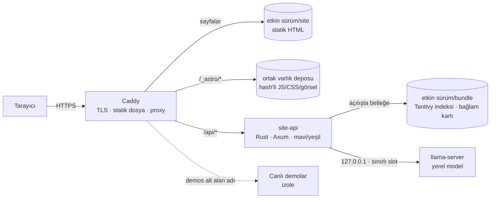
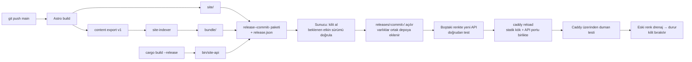
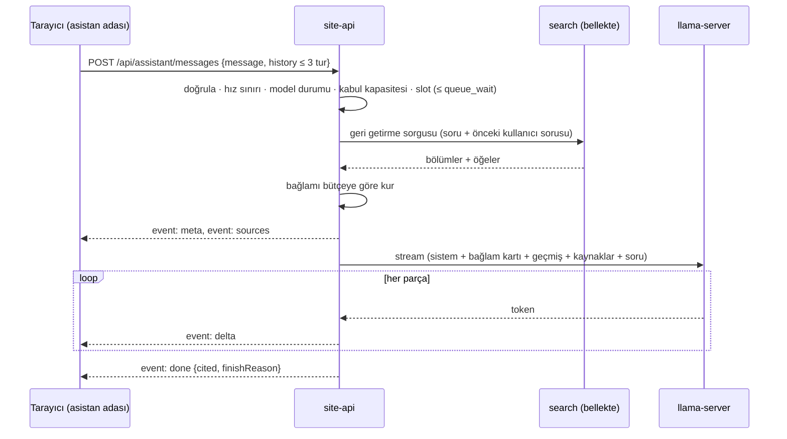

# Kişisel Web Sitesi — Teknik Mimari v2

Sürüm: 2.2 — alternatif mimari önerisi
Tarih: 26 Ekim 2026
Durum: Öneri. Onaylanırsa [TEKNIK_MIMARI.md](TEKNIK_MIMARI.md) (v1) belgesinin yerine geçer. Uygulama kodu yok.

Değişiklik kaydı:

- 2.2: Uygulama fazlarıyla ([fazlar/](fazlar/README.md)) hizalama. `deployctl` ve `site-eval` crate'leri (5, 8.1); asistan bağlamında geçmiş artık kaynaklardan önce (10.1, 10.2); `forbidden_origin` ve `not_found` hata kodları (11.2); lansman öncesi kip `SITE_MODE` (7); Faz 1'in Rust odağı (20).
- 2.1: İnceleme düzeltmeleri. Mavi/yeşil API geçişi ve tek Caddy yeniden yüklemesi (D-03, 18.2); dağıtım kilidi ve eski commit reddi (D-11, 18.2); sürümler arası ortak varlık deposu ve sürüm farkı kuralları (D-12, 7.1); iki aşamalı istek kabulü (8.4, 10.6); Caddy `flush_interval -1` kaldırıldı, iptal uçtan uca test edilir (11.3, 17.2); intro için animasyondan bağımsız emniyet (12.3).
- 2.0: İlk sürüm.

İlgili belgeler:

- [PROJE_KAPSAMI.md](PROJE_KAPSAMI.md): ürünün amacı ve işlevleri (değişmedi).
- [TASARIM.md](TASARIM.md): görsel yön ve hareket (değişmedi).
- [TEKNIK_MIMARI.md](TEKNIK_MIMARI.md): v1 önerisi; farklar 22. bölümde.

Klasör ağacı, sözleşme alanları, crate adları ve başlangıç limitleri tasarım önerisidir. Kütüphane sürümleri uygulama başlangıcında doğrulanıp kilitlenir.

## Bir bakışta

- **İçerik git'te yaşar.** Markdown/MDX dosyaları ve bir etiket sözlüğü. Yayın = commit + otomatik sürüm.
- **Sayfalar statik üretilir.** Astro + React adaları (arama, asistan, hero, intro). Üretimde Node.js süreci yok.
- **Rust iki iş yapar:** derleme zamanında içerikten arama/asistan paketi (bundle) üretir; çalışma zamanında arama ve asistan API'sini sunar.
- **Model ayrı bir süreçtir.** llama.cpp `llama-server` yalnız localhost'ta çalışır; Rust ona sınırlı sayıda slot üzerinden erişir.
- **v1'de veritabanı yok.** Sunucuda tek kopyası olan veri yok; sunucu kaybı içerik kaybı değildir.
- **Her sürüm tek parçadır.** Site + bundle + binary aynı commit'ten üretilir; yeni API hazır olduktan sonra tek bir Caddy yeniden yüklemesiyle devreye girer, aynı yolla geri alınır.



## 1. Tasarım tezi

v1 belgesi, çok yazarlı bir içerik yönetim sisteminin sorunlarını titizlikle çözüyor: eşzamanlı düzenleme, revision, outbox, lease, sürümlü projection'lar, medya telafisi, geri yüklemede yan etki uzlaştırma. Bu sorunların neredeyse tamamı tek bir tercihten doğuyor: içeriğin çalışan sunucuda değiştirilebilir durum olarak tutulması ve türetilmiş verilerin (arama, AI bağlamı, sayfa cache'i) ona asenkron olarak yetişmeye çalışması.

Bu projenin gerçek profili:

| Özellik | Değer | Mimari sonucu |
| --- | --- | --- |
| Yazar sayısı | 1 | Eşzamanlı düzenleme sorunu yok. |
| Yazma sıklığı | Ayda birkaç güncelleme (varsayım) | Yayın birkaç dakika sürebilir. |
| Okuma/yazma oranı | Neredeyse tamamen okuma | İçerik derleme zamanında işlenebilir. |
| İçerik hacmi | Onlarca proje, birkaç sayfa | İndeks ve gerekirse vektörler belleğe sığar. |
| Sunucu | Tek makine | Dağıtık koordinasyon gereksiz; süreç izolasyonu yeterli. |
| En pahalı kaynak | Yerel dil modeli | Asıl mühendislik, kaynak koruma ve bağlam kalitesindedir. |

**Tez: Değiştirilebilir durumu sunucudan çıkar; geriye kalan tek pahalı kaynağı (modeli) koru.**

İçerik derleme zamanında değişmez bir pakete dönüştüğünde, v1'deki tutarlılık garantilerini ayrı mekanizmalarla sağlamak gerekmez; bu garantiler yapının doğal sonucu olur. Kalite, önce hata yollarını ortadan kaldırarak, sonra kalanları test ederek elde edilir. Kalan gerçek riskler bu belgenin odağıdır: model kapasitesi, Türkçe arama kalitesi, hero performansı ve stream iptali.

## 2. Kararlar

### 2.1 Sabit girdiler (kullanıcı kararı)

| Konu | Karar |
| --- | --- |
| Backend dili | Rust (ilk Rust projesi) |
| Çalışma ortamı | Kullanıcının kendi sunucusu |
| Yapay zekâ | Sunucuda, istek başına ücret gerektirmeyen yerel model |
| Geliştirme | AI destekli; IM2026 kalite seviyesi |
| Tasarım | [TASARIM.md](TASARIM.md): Dennis yönü, üstte arama, sağda sabit asistan, çok dilli intro, portre akışı |

### 2.2 Bu belgenin kararları

| No | Karar | Kısa gerekçe | Ne zaman yeniden değerlendirilir |
| --- | --- | --- | --- |
| ADR-01 | İçerik git deposunda Markdown/MDX; yönetim paneli yok | Tek yazar; geçmiş, diff, geri alma ve yedek git'ten gelir | İkinci yazar, telefondan düzenleme veya teknik olmayan editör ihtiyacı |
| ADR-02 | v1'de veritabanı yok | Kalıcı ve değişken veri yok | Ziyaretçinin yazdığı veri ihtiyacı (geri bildirim, form) → önce SQLite |
| ADR-03 | Frontend: Astro statik çıktı + React adaları | Sunucu render ihtiyacı yok; az JS; sayfa geçişleri hazır | Kişiye özel veya dinamik sayfa ihtiyacı |
| ADR-04 | Arama: Tantivy, Rust API içine gömülü | Arama kutusu ve asistan aynı motoru kullanır; ayrı servis yok | Çok dilli içerik veya on binlerce belge |
| ADR-05 | Model: llama.cpp `llama-server`, ayrı süreç | Slot, önek önbelleği, iptal ve kuantizasyon üzerinde doğrudan kontrol | Runtime kalite veya kararlılık sorunu |
| ADR-06 | Sürüm klasörleri + mavi/yeşil API + tek Caddy yeniden yüklemesiyle geçiş; systemd | Kesintisiz geçiş; hızlı geri alma; konteyner zorunlu değil | Birden fazla sunucu |
| ADR-07 | Durumsuz sohbet; geçmiş tarayıcıda | Gizlilik ve basitlik | Konuşma paylaşımı veya analizi ihtiyacı |
| ADR-08 | Bir sözleşmenin sahibi onu üreten taraftır | Tek kaynaktan tip üretimi + CI doğrulaması | — |

Kısa ADR dosyaları uygulama başlangıcında bu tablodan `docs/adr/` altında açılır.

## 3. Mimari değişmezler

| No | Değişmez |
| --- | --- |
| D-01 | Sunucuda tek kopyası bulunan kalıcı veri yoktur. Sunucu kaybolursa depo + model dosyasından yeniden kurulur. |
| D-02 | Bir sürüm, aynı commit'ten üretilmiş site + bundle + API binary'sidir; parçalar ayrı ayrı güncellenmez. |
| D-03 | Sayfalar, arama ve asistan aynı sürümden üretilir. Geçişten sonra gelen her yeni istek üçünde de aynı sürümü görür. Açık kalmış eski sekmeler eski sürümde kalabilir; bu fark algılanır ve zararsız kılınır (7.1). |
| D-04 | Public sayfalar JavaScript, API ve model olmadan okunabilir ve gezilebilir. |
| D-05 | Model yalnızca metin üretir; araç, ağ, dosya veya yazma yetkisi yoktur. |
| D-06 | Kaynak bağlantıları modelin metninden değil, sunucunun seçtiği kaynak listesinden üretilir. |
| D-07 | Her pahalı kaynak sınırlıdır: istek boyutu, kuyruk, eşzamanlı üretim, süre, çıktı. Sınır aşımı sessiz bekleme değil, açık bir yanıttır. |
| D-08 | Bir veri sözleşmesinin sahibi onu üreten taraftır; tüketen taraf CI'da doğrular. |
| D-09 | Ziyaretçi soruları ve kimliği kalıcı saklanmaz. IP adresi yalnız bellek içi hız sınırında kullanılır. |
| D-10 | Geri alma, önceki sürümü seçmek kadar basittir ve düzenli olarak denenir. |
| D-11 | Dağıtım ve geri alma tek kilit altında, sırayla çalışır. Otomatik bir süreç etkin sürümü daha eski bir commit'le değiştiremez. |
| D-12 | Yayımlanmış bir sayfanın istediği hash'li varlık, o sayfanın sürümü etkinlikten çıktıktan sonra en az 30 gün erişilebilir kalır. |

## 4. Sistem görünümü

### 4.1 Süreçler

| Süreç | Görev | Adres | Not |
| --- | --- | --- | --- |
| Caddy | Otomatik TLS, statik dosya, `/api` proxy, güvenlik başlıkları, log maskeleme; etkin sürümü tek yapılandırma yeniden yüklemesiyle değiştirir | 80/443 | Tek public süreç |
| site-api (mavi/yeşil) | Arama, asistan, sağlık, metrikler | Mavi 127.0.0.1:8080 + 9090 (metrik); yeşil 127.0.0.1:8082 + 9092 | Kendi sürüm klasörünün bundle'ını açılışta belleğe alır. Normalde yalnız bir renk çalışır; geçişte kısa süre ikisi birlikte çalışır |
| llama-server | Model çıkarımı | 127.0.0.1:8081 | API anahtarı; yalnız localhost; düşük CPU önceliği |

Astro derlemesi ve `site-indexer` (Rust CLI) yalnız CI'da çalışır; sunucuda derleme yapılmaz.

### 4.2 Arıza matrisi

| Duran bileşen | Sayfalar | Arama | Asistan | Ziyaretçinin gördüğü |
| --- | --- | --- | --- | --- |
| llama-server | Çalışır | Çalışır | Kapalı | Panelde "Asistan şu an çevrim dışı" ve ilgili sayfa önerileri |
| site-api | Çalışır | Kapalı | Kapalı | Arama alanı etiket sayfalarına yönlendirir; panel çevrim dışı |
| JavaScript yok veya hata | Çalışır | — | — | İçerik ve etiket sayfaları eksiksiz çalışır |
| WebGL yok veya düşük güç | Çalışır | Çalışır | Çalışır | Statik portre |
| Caddy | Kapalı | Kapalı | Kapalı | Harici uptime uyarısı |

## 5. Depo düzeni ve sahiplik

Tek depo:

```text
/
├─ content/                         İçeriğin tek kaynağı
│  ├─ profile.md                    isim, unvan, kısa tanıtım, bağlantılar; gövde: hakkımda
│  ├─ projects/<slug>/index.mdx     proje metni + front-matter
│  ├─ projects/<slug>/*.jpg|png     projenin görselleri, yanında durur
│  └─ tags.yaml                     etiket sözlüğü ve eşanlamlılar
├─ web/                             Astro uygulaması
│  ├─ src/content.config.ts         Zod şemaları; content/ klasörünü okur
│  ├─ src/pages/                    /, /projeler, /projeler/[slug], /hakkimda, /ara
│  ├─ src/pages/internal/           derlemede content export üretir (yayımlanan siteden çıkarılır)
│  ├─ src/islands/                  search/, assistant/, hero/, intro/ (React)
│  ├─ src/styles/                   token'lar ve global stiller
│  └─ src/generated/                Rust'tan üretilen TS tipleri (elle düzenlenmez)
├─ backend/
│  ├─ Cargo.toml                    workspace
│  └─ crates/
│     ├─ contract/                  export v1, API DTO'ları, SSE olayları (serde + ts-rs)
│     ├─ search/                    Türkçe analiz, indeks kurma ve okuma, sorgu, sıralama
│     ├─ assistant/                 bağlam kartı, bağlam kurma, prompt, model istemcisi, atıf
│     ├─ indexer/                   bin: export → bundle
│     ├─ api/                       bin: Axum sunucusu
│     ├─ deployctl/                 bin: sunucuda sürüm geçişi, geri alma, izleme
│     └─ eval/                      bin: arama/asistan değerlendirmesi, ölçüm, yük testi
├─ eval/                            arama ve asistan soru setleri
├─ deploy/                          Caddyfile, systemd unit'leri, sürüm betikleri, model.toml, RUNBOOK.md
├─ docs/adr/
├─ justfile                         dev, check, index, eval, release, rollback
└─ AGENTS.md                        AI kodlama asistanları için kurallar ve komutlar
```

Sahiplik kuralları:

- İçeriği ayrıştırmak, render etmek ve URL üretmek **yalnız Astro'nun** işidir. Rust Markdown render etmez, URL kurmaz; export'taki düz metin bölümlerini ve hazır URL'leri kullanır.
- Arama sıralaması, bağlam seçimi ve model erişimi **yalnız Rust'ın** işidir. Frontend sonuçları yeniden sıralamaz veya süzmez.
- Sözleşme yönleri (D-08):
  - **Content export v1:** Astro üretir → Rust `deny_unknown_fields` ile okur. CI, gerçek export'u indeksleyiciye doğrulatır. Yeni bir alan eklemek de bilinçli bir sözleşme değişikliğidir.
  - **API DTO'ları ve SSE olayları:** Rust üretir → `ts-rs` TS tiplerini `web/src/generated/` altına yazar. CI tipleri yeniden üretir ve fark varsa başarısız olur.

## 6. İçerik modeli

### 6.1 Koleksiyonlar

| Koleksiyon | Dosya | Temel alanlar |
| --- | --- | --- |
| profile | `content/profile.md` | name, headline, shortBio (≤ 300 karakter), skills[], links (email, github, linkedin, cv); gövde: hakkımda metni |
| projects | `content/projects/<slug>/index.mdx` | title, summary (tek cümle, ≤ 160 karakter), role, tags[], year, featured, order, cover (src, alt), repo?, demo? (kind: static/service, url), draft |
| tags | `content/tags.yaml` | id, label, aliases[], group |

Şemalar Zod ile tanımlanır; proje `tags` alanı koleksiyon referansıyla doğrulanır. Bilinmeyen etiket, eksik `alt` metni, bulunmayan görsel veya sınırı aşan özet derlemeyi durdurur; hata dosya ve alan adını gösterir.

```yaml
# content/tags.yaml
- id: dotnet
  label: .NET
  aliases: [".net", "dotnet", "asp.net", "asp.net core"]
  group: framework
- id: csharp
  label: C#
  aliases: ["c#", "csharp", "c sharp"]
  group: dil
```

Eşanlamlılar aramada ve asistanda teknoloji adlarını tanımak için kullanılır (9.3).

### 6.2 Yazım ve yayın akışı

1. Metin VS Code'da düzenlenir; `just dev` ile sayfa canlı önizlenir.
2. `just check` şemayı, bağlantıları ve görselleri doğrular; `just index` yerel arama/asistan paketini üretir.
3. Commit + push → CI → sürüm → dağıtım (7. bölüm).
4. `draft: true` içerik üretim derlemesine, export'a ve indekse girmez.

Yayından kaldırmak için dosya silinir veya `draft: true` yapılır ve yeni sürüm çıkar. Yeniden yayımlamak git geçmişinden geri almaktır. Yayın denetim kaydı git log'dur.

### 6.3 Görseller

- Orijinal görseller içerikle birlikte depoda tutulur; dosya başına üst sınır şemada (ör. 5 MB).
- AVIF/WebP varyantları, `srcset` ve genişlik/yükseklik Astro görsel hattında derleme zamanında üretilir. Boyutlar her zaman HTML'de olur (CLS önlemi).
- Portre için ek katman varlıkları gerekir: arka planı ayrılmış portre (alfa) ve öne geçen akış için maske (12.4).
- AI ile üretilmiş örnek portreler üretime taşınmaz.
- Video veya büyük medya ihtiyacı ayrı karardır (Git LFS veya nesne deposu).

### 6.4 Content export v1

Astro derlemesinde statik bir endpoint ile üretilen JSON dosyasıdır. Sürüm betiği bu dosyayı yayımlanan site klasöründen çıkarıp indeksleyiciye verir. Rust tarafının içerikle ilgili tek girdisidir.

```text
ExportV1
  schemaVersion: 1
  release:  { gitCommit }                         zaman damgası yok: aynı commit → aynı export
  site:     { name, headline, shortBio, skills[], links }
  tags:     [{ id, label, aliases[], group }]
  items:    [{
    id        "project/<slug>" veya "page/about"
    kind      project | page
    url       kanonik yol (Astro üretir)
    title, summary, tags[], year, featured, order
    links     { repo?, demo? }
    sections  [{ anchor, heading, url, text }]    url hazır bağlantıdır (Rust URL kurmaz)
  }]
```

Bölüm metinleri Markdown AST'sinden (remark) düz metne çevrilir. Başlık anchor'ları, Astro'nun sayfada ürettiği id'lerle aynı slug fonksiyonundan gelir; asistanın verdiği bölüm bağlantısı sayfada gerçekten vardır.

## 7. Derleme ve sürüm hattı



Sunucudaki düzen:

```text
/srv/site/
  releases/<commit>/{site/, bundle/, bin/site-api, release.json}
  assets/_astro/                    sürümler arası ortak, değişmez hash'li varlıklar
  active.json                       etkin sürüm, renk, port ve geçiş geçmişi
  active.caddy                      Caddyfile'ın içe aktardığı parça: statik kök + API portu
  deploy.lock                       dağıtım ve geri alma kilidi
  config/site-api.toml              sürümden bağımsız ortam ayarları
  models/<model>.gguf               sürümden bağımsız; checksum deploy/model.toml'da
```

Kurallar:

- Aynı commit aynı bundle içeriğini üretir: sıralama deterministiktir, zaman damgası yalnız `release.json`'da bulunur.
- Sunucuda son 5 sürüm klasörü tutulur. Geri alma (`just rollback <commit>`) dağıtımla aynı kilidi ve aynı geçiş adımlarını kullanır.
- Geçişte kesinti yoktur: yeni API örneği hazır ve test edilmiş olmadan trafik ona yönelmez; eski örnek süren akışlarını bitirerek kapanır (18.2).
- Yalnız içerik değişse de bütün hat çalışır (D-02). Rust derleme önbelleğiyle süre birkaç dakikadır; ayrı bir "yalnız içerik" yolu açılmaz.
- Lansman öncesi kip (`SITE_MODE=prelaunch`): sayfalar `noindex`, `robots.txt` her şeyi kapatır, yer tutucu içeriğe izin verilir. `public` kipinde yer tutucu içerik derlemeyi durdurur. Geçiş lansman kontrol listesiyle yapılır.

### 7.1 Açık sekmeler ve sürüm farkı

Geçiş anında açık olan sekmeler eski sürümün HTML'iyle çalışmaya devam eder. Bu önlenemez; zararsız kılınır:

- **Ortak varlık deposu (D-12):** Astro'nun hash'li çıktıları (`/_astro/*`) sürüm klasöründen değil `/srv/site/assets/_astro/` deposundan sunulur. Her dağıtım kendi dosyalarını geçişten önce ekler; mevcut dosyaların üzerine yazılmaz (aynı ad, aynı içerik demektir). Etkin sürümün dosyaları hiç silinmez. Bir dosya, onu kullanan son sürüm etkinlikten çıktıktan 30 gün sonra silinebilir. Bunun için her sürüm kendi varlık listesini `release.json`'da taşır; geçiş zamanları `active.json` geçmişinde tutulur. Buna rağmen bir parça yüklenemezse (ör. 30 günden eski bir sekme) ada hatayı yakalar ve sayfayı bir kez yeniden yükler.
- **Sürüm kimliği:** Her HTML `<meta name="release">` taşır; API yanıtları (arama gövdesi, SSE `meta` olayı) kendi sürümünü bildirir. Commit farkı tek başına hata değildir.
- **Gezinme:** `ClientRouter` ile gezinmede gelen sayfanın sürümü farklıysa gezinme tam sayfa yüklemesine çevrilir. Kalıcı asistan adası da böylece yeni kodla yüklenir; konuşma `sessionStorage`'dan geri gelir (12.2).
- **API sözleşmesi:** `contract` crate'i bir sözleşme numarası tanımlar; istemci her istekte `X-Contract-Version` gönderir. Sürümler arası değişiklikler eklemeli yapılır (yeni, isteğe bağlı alan) ve numarayı değiştirmez. Geriye uyumsuz değişiklikte numara artar; API, desteklediği en eski numaranın altındaki istemciye 409 `client_outdated` döner, arayüz "Site güncellendi, sayfayı yenileyin" gösterir.
- **Kaldırılmış içerik:** Eski bir sekmeden kaldırılmış bir projeye gidilirse 404 sayfası arama alanını ve proje listesi bağlantısını gösterir.

## 8. Rust backend

### 8.1 Crate'ler ve bağımlılık yönü

| Crate | Sorumluluk | Proje içi bağımlılık | Bilerek bağımlı olmadığı |
| --- | --- | --- | --- |
| contract | Export v1, API DTO'ları, SSE olay tipleri | — | tokio, axum, tantivy |
| search | Türkçe analiz zinciri, indeks kurma/okuma, sorgu ayrıştırma, sıralama | contract | axum, ağ |
| assistant | Bağlam kartı, bağlam kurma, prompt şablonu, model istemcisi, atıf ayrıştırma | contract, search | axum |
| indexer (bin) | Export'u doğrular → böler → Tantivy indeksi + bağlam kartı + manifest | contract, search, assistant | ağ (çevrimdışı çalışır) |
| api (bin) | Axum route'ları, SSE, hız sınırı, yapılandırma, telemetri, kontrollü kapanış | contract, search, assistant | — |
| deployctl (bin) | Sürüm paketi, kilit, mavi/yeşil geçiş, varlık deposu, geri alma, model uygulama, izleme | — (senkron; yalnız dosya, süreç ve HTTP) | tokio, axum |
| eval (bin) | `site-eval`: arama ve geri getirme değerlendirmesi, üretim raporu, model ölçümü, yük testi | contract, search, assistant | — |

v1'deki katman crate'leri (domain/application/infrastructure/http/host) yerine **yetenek crate'leri** kullanılır. Bu sistemde zengin iş kuralı yok; karmaşıklık arama kalitesinde, bağlam seçiminde, akışta ve kaynak sınırlarında. Katmanlar bu crate'lerin içinde modül düzeyinde kalır: ör. `assistant::context` saf fonksiyonlardır, `assistant::model` I/O yapar.

Trait/port yalnız gerçekten değişen veya test için sahtesi gereken sınırda açılır. Bugün böyle tek sınır var: **dil modeli**. Bundle dosyadan okunur. Repository, unit of work, event bus veya DI çatısı yok.

### 8.2 Uygulama durumu

```rust
// Taslak — derlenmiş kod değildir.
#[derive(Clone)]
pub struct AppState {
    bundle: Arc<Bundle>,       // değişmez; sürüm başına bir kez yüklenir
    model: Arc<ModelClient>,
    admission: Arc<Semaphore>, // kabul kapasitesi = slot + kuyruk (ör. 2 + 4)
    slots: Arc<Semaphore>,     // eşzamanlı üretim = llama-server slot sayısı
    limits: Arc<Limits>,       // açılışta doğrulanmış yapılandırma
}
```

Bundle sürüm boyunca değişmediği için kilit gerekmez. Sıcak yeniden yükleme gerekirse `Arc<Bundle>` yerine `ArcSwap<Bundle>` kullanılır.

### 8.3 Model istemcisi: enum ile dağıtım

```rust
pub enum ModelClient {
    LlamaServer(LlamaServerClient), // OpenAI uyumlu /v1/chat/completions, stream
    Fake(FakeModel),                // testler ve modelsiz yerel geliştirme
}
```

İki somut uygulama için `dyn` async trait yerine enum seçilir. Kutulama ve `Send` sınırlarıyla erken uğraşmayı önler, ilk Rust projesinde okunabilirliği artırır. Üçüncü bir runtime eklenirse yeniden değerlendirilir.

### 8.4 Akış, slot ve iptal: güvenceyi sahiplik sağlar

```rust
// Taslak — derlenmiş kod değildir.
async fn post_message(
    State(app): State<AppState>,
    Json(req): Json<MessageRequest>,
) -> Result<Sse<impl Stream<Item = Result<Event, Infallible>>>, ApiError> {
    let input = req.validate(&app.limits)?;                         // 400 / 413
    app.model.ensure_available()?;                                  // 503 assistant_offline

    // 1. Kabul: etkin + bekleyen istek sayısı sınırlı; doluysa hiç beklemeden reddet.
    let admitted = app.admission.clone().try_acquire_owned()
        .map_err(|_| ApiError::Busy)?;                              // 503 assistant_busy
    // 2. Slot: kabul edilmiş istek en fazla queue_wait kadar bekler (tokio Semaphore FIFO'dur).
    let slot = timeout(app.limits.queue_wait, app.slots.clone().acquire_owned())
        .await
        .map_err(|_| ApiError::Busy)??;                             // 503 assistant_busy
    let plan = assistant::plan(&app.bundle, &input, &app.limits);   // arama + bağlam, model yok

    let events = async_stream::stream! {
        let _permits = (admitted, slot);     // iki izin de akışla aynı ömrü paylaşır
        yield Ok(plan.meta_event());
        yield Ok(plan.sources_event());      // kaynaklar ilk token'dan önce görünür
        // model akışı: delta olayları, süre/çıktı sınırları, tek terminal olay (done | error)
    };
    Ok(Sse::new(events).keep_alive(KeepAlive::default()))
}
```

Bekleyen istek sayısını kabul semaforu sınırlar. Slot beklemesindeki süre sınırı bekleyen sayısını sınırlamaz, yalnız ne kadar bekleneceğini sınırlar. Kabul kapasitesi dolduğunda yeni istek kuyruğa hiç girmez.

Akış düştüğünde iki izin de serbest kalır ve llama-server'a giden HTTP isteği kapanır. Slot sızıntısı veya unutulmuş `finally` riski sahiplik kurallarıyla kapanır; .NET'teki `try/finally` disiplininin yerini tip sistemi alır.

Bu güvence yalnız sürecin içinde geçerlidir. Tarayıcının bağlantıyı kopardığı bilgisinin Axum'a ulaşması proxy'ye bağlıdır: Caddy'de `flush_interval -1` ayarı, istemci ayrıldığında arka uç isteğinin iptal edilmemesine yol açar ([Caddy dokümanı](https://caddyserver.com/docs/caddyfile/directives/reverse_proxy)). Bu yüzden bu ayar kullanılmaz (11.3). llama-server'ın bağlantı kapanınca üretimi durdurduğu da varsayılmaz. "Kopuş → slot boşalır → üretim durur" zinciri gerçek tarayıcı → Caddy → Axum → llama-server yolunda test edilir (17.2, senaryo 1).

### 8.5 Hata, async ve kod kuralları

- Kütüphane crate'lerinde `thiserror` ile tipli hata enum'ları; binary açılışında ve CLI'da `anyhow`.
- API'de tek `ApiError` → `IntoResponse` ile `application/problem+json`, kararlı `code` ve `traceId`.
- `api` ve `assistant` crate'lerinde `clippy::unwrap_used` ve `clippy::expect_used` reddedilir (testler hariç).
- Tantivy sorguları senkron ve kısadır; ölçüm 1 ms'yi aşarsa `spawn_blocking`'e taşınır.
- Zaman aşımları `tokio::time::timeout`; testlerde `tokio::time::pause` ile deterministik.
- Kimlikler newtype'tır: `ItemId`, `ChunkId`, `TagId`, `SourceLabel`.
- `cargo-deny` lisans ve güvenlik bildirimlerini denetler.

## 9. Arama

### 9.1 Neden Tantivy

| Seçenek | Değerlendirme |
| --- | --- |
| **Tantivy (seçilen)** | Rust kütüphanesi, API sürecine gömülü. BM25, alan ağırlıkları, Snowball Türkçe stemmer, fuzzy sorgu. İndeks derlemede kurulur, çalışma zamanında yalnız okunur. |
| PostgreSQL FTS | Veritabanı gerektirir (ADR-02); Türkçe sözlük ek iş ister. |
| Pagefind (tarayıcıda) | Sunucusuz ve dayanıklı; ama asistan ayrı bir arama motoru kullanmak zorunda kalır. |
| Meilisearch, OpenSearch | Ayrı süreç ve işletim yükü; bu hacimde gereksiz. |

Ana gerekçe: **Arama kutusunun bulduğu ile asistanın okuduğu aynı motordan gelir.** Asistan kötü bir cevap verdiğinde, soruyu arama kutusuna yazmak hangi kaynakların seçildiğini gösterir. Aramadaki her iyileştirme asistana da yansır.

### 9.2 Belge türleri ve alanlar

İki belge türü vardır: öğe (proje/sayfa) ve bölüm (chunk). Uzun bölümler paragraf sınırında yaklaşık 350 token'lık parçalara ayrılır; her parçanın başına "Proje: X — Bölüm: Y" eklenir.

| Alan | Analiz | Başlangıç ağırlığı | Amaç |
| --- | --- | --- | --- |
| title | tr_stem + tr_fold | 3.0 | Başlık eşleşmesi |
| tags (eşanlamlılar dahil) | tam terim | 2.5 | Teknoloji eşleşmesi |
| summary | tr_stem + tr_fold | 1.5 | Özet |
| heading | tr_stem | 1.5 | Bölüm başlığı |
| text | tr_stem + tr_fold | 1.0 | Gövde |
| title_prefix | edge n-gram (2–15) | 1.0 | Yazarken öneri |

Analiz zincirleri:

- **tr_stem:** tokenizer → Türkçe küçük harf dönüşümü → Snowball Türkçe stemmer. Dönüşüm özel yazılır (`I→ı`, `İ→i`); varsayılan Unicode küçültme "I"yı "i" yapar ve Türkçe eşleşmeleri bozar.
- **tr_fold:** küçültmenin ardından ASCII katlama (`ç→c, ğ→g, ı→i, ö→o, ş→s, ü→u`). Türkçe karakter kullanmadan yazılan sorgular için ("ogrenci", "gelistirdigim").
- Teknoloji adları tokenizer'a bırakılmaz (9.3).

### 9.3 Sorgu işleme

1. Normalize et: Unicode NFC, boşluklar, uzunluk sınırı (200 karakter).
2. **Önce etiket sözlüğü eşleşir.** `.NET`, `C#`, `C++`, `Node.js`, `ASP.NET Core` gibi ifadeler eşanlamlı tablosunda en uzun eşleşmeyle tanınır, etiket filtresine/boost'una dönüşür ve sorgu metninden çıkarılır. Aksi halde tokenizer `C#`'ı `c`'ye, `.NET`'i `net`'e indirger.
3. Kalan metin tr_stem ve tr_fold alanlarında çoklu alan sorgusuna dönüşür. 5+ karakterli terimlerde başlıkta tek harf hatası tolere edilir.
4. Bölüm sonuçları öğe düzeyinde gruplanır; her öğenin en iyi bölümü vurgulanır.
5. Eşit puanda kararlı ikinci anahtar: `featured`, `order`, `slug`.
6. Sonuç sayısı sınırlıdır: varsayılan 8, en fazla 20.

### 9.4 Kalite ölçümü

`eval/search.toml`: sorgu → beklenen ilk 3 öğe. Türkçe varyasyonlar (ekler, şapkasız yazım, İ/ı), teknoloji adları, yazım hataları ve "hiçbir şey bulunmamalı" vakaları içerir. CI her değişiklikte çalıştırır; sonuçlar `insta` anlık görüntüleriyle karşılaştırılır. Alan ağırlıkları bu setle ayarlanır.

### 9.5 Anlamsal aramaya geçiş koşulu

v1 kelime tabanlıdır. Asistan değerlendirmesinde (10.8) beklenen kaynağın ilk 5'te bulunma oranı hedefin altında kalırsa veya Türkçe içerikte İngilizce sorgular önem kazanırsa:

- İndeksleyici, çok dilli bir embedding modeliyle (ör. multilingual-e5 veya bge-m3 ailesi) bölüm vektörlerini üretip bundle'a yazar.
- Sorgu vektörü çalışma zamanında üretilir (llama-server embedding kipi veya gömülü ONNX).
- Birkaç bin vektör için doğrudan kosinüs taraması yeterlidir; pgvector veya vektör veritabanı gerekmez.
- Kelime ve vektör sonuçları Reciprocal Rank Fusion ile birleşir. Embedding servisi yoksa kelime aramasına düşülür.
- Embedding modelinin kimliği bundle manifestinde tutulur; uyumsuz vektörler yüklenmez.

## 10. Yapay zekâ asistanı

### 10.1 Akış



Kaynakların ilk token'dan önce gönderilmesi, yavaş donanımda ziyaretçinin bekleme sırasında "okunan kaynakları" görmesini sağlar.

### 10.2 Bağlam düzeni ve bütçesi

Prompt sırası, llama-server'ın önek önbelleğini en iyi kullanacak biçimde sabittir:

| Sıra | Blok | Ne zaman değişir | Başlangıç bütçesi |
| --- | --- | --- | --- |
| 1 | Sistem talimatı: rol, kapsam, atıf ve çekimserlik kuralları | Sürümde | ~400 token |
| 2 | Bağlam kartı: kim, ne yapar, proje listesi (başlık · tek cümle · etiketler) | Sürümde | ≤ 1.200 token |
| 3 | Geçmiş: son 3 tur, kısaltılmış, atıf işaretleri silinmiş | Turda bir büyür | ≤ 600 token |
| 4 | Kaynaklar `[K1]…[Kn]`: geri getirilen bölümler (soruyla aynı kullanıcı mesajında) | Her soruda | ≤ 1.500 token |
| 5 | Soru | Her soruda | ≤ 500 karakter |
| — | Cevap | — | ≤ 500 token |

1 ve 2 her istekte bayt bayt aynı olduğundan model bu öneki yeniden hesaplamaz. Geçmiş, aynı konuşmanın sonraki turunda da önekin parçası olarak kalır; her soruda değişen kaynaklar en sona, sorunun yanına konur. CPU'da istem işleme baskın maliyet olduğu için bu sıra ve bütçeler bir performans kararıdır, biçim tercihi değil.

- Bağlam kartı indeksleyicide üretilir. Bütçeyi aşarsa derleme durur ve yazar özetleri kısaltır. Token sayısı derlemede yaklaşık hesaplanır; API açılışta llama-server tokenizer'ıyla gerçek değeri ölçüp loglar.
- "Hangi projeler üzerinde çalıştın?" türü sorular bağlam kartından cevaplanır; geri getirmeye bağlı değildir.
- Teknoloji sorusu ("C# kullandığın projeler?") etiket sözlüğüyle tanınırsa, o etiketi taşıyan projelerin listesi kaynak bloğuna deterministik olarak eklenir; liste geri getirme şansına bırakılmaz.
- Cevap dili sorunun dilini izler; kaynaklar Türkçedir.

### 10.3 Takip soruları

Geri getirme sorgusu = mevcut soru + bir önceki kullanıcı sorusu. Önceki cevapta atıf yapılan öğeler hafifçe öne alınır. Soruyu ek bir LLM çağrısıyla yeniden yazmak v1'de yok; CPU'da ikinci çağrı gecikmeyi ikiye katlar. Değerlendirme gerektirirse eklenir.

### 10.4 Atıf ve kaynak kuralları

- Model, kaynakları `[K2]` biçiminde etiketiyle anmaya yönlendirilir.
- `sources` olayı sunucunun seçtiği kaynakları taşır: etiket, öğe id, başlık, URL. URL, export'taki kanonik adres ve bölüm anchor'ından gelir (D-06).
- Cevap bitince sunucu metindeki etiketleri ayrıştırır; `done.cited` yalnız geçerli etiketleri içerir. Arayüz geçerli etiketleri kaynak kartına bağlar, geçersizleri düz metin gösterir.
- Cevap Markdown'ı güvenli bir alt kümeyle gösterilir: ham HTML yok; model metnindeki hiçbir bağlantı (site içi yollar dahil) tıklanabilir değildir. Tıklanabilir olanlar yalnız `sources` listesine dayanan `[Kn]` numaraları ve kaynak kartlarıdır.

### 10.5 Güvenlik sınırları

- Modelin araç, ağ, dosya veya yazma erişimi yoktur (D-05). İstem enjeksiyonunun en kötü sonucu yanlış veya konu dışı metindir; bu mimarinin bilinçli sınırıdır.
- İstemcinin gönderdiği geçmiş güvenilmez metindir: roller sunucuda yeniden kurulur, en fazla 3 tur ve karakter sınırıyla kesilir, `system` rolü kabul edilmez.
- Konu dışı istekler (genel kod yazma, başka kişiler hakkında sorular vb.) kibarca reddedilir ve site konularına yönlendirilir.
- Kaynakta bilgi yoksa "Bu konuda sitede bilgi yok" demek doğru davranıştır ve değerlendirmede ödüllendirilir.

### 10.6 Kapasite ve koruma

| Sınır | Başlangıç değeri | Aşılınca |
| --- | --- | --- |
| Mesaj uzunluğu | 500 karakter | 413 `message_too_long` |
| Geçmiş | 3 tur, toplam 2.000 karakter | Sunucuda kesilir |
| IP başına mesaj | 5/dk, 60/gün | 429 + `Retry-After` |
| IP başına arama | 20 / 10 sn | 429 |
| Eşzamanlı üretim | llama-server `--parallel` değeri (ör. 2) | Kabul edilmiş istek slot bekler |
| Kabul kapasitesi | Etkin + bekleyen ≤ slot + 4 (ör. 6) | Anında 503 `assistant_busy`; kuyruğa girmez |
| Slot bekleme | En fazla 15 sn | 503 `assistant_busy` |
| İlk token süresi | 30 sn | `error: model_timeout` |
| Toplam süre | 90 sn | `error: generation_timeout`; kısmi cevap tamamlanmış sayılmaz |
| Çıktı | 500 token | `done.finishReason = length` |
| İstek gövdesi | 16 KB | 413 |

Değerler yapılandırmadan okunur ve gerçek donanımda ölçülerek ayarlanır. Gerçek IP yalnız Caddy'nin eklediği başlıktan ve yalnız localhost'tan gelen istekte okunur. Asistan POST'larında `Origin` site adresi değilse istek reddedilir. Bu bir güvenlik garantisi değildir; başka sitelerin asistanı gömmesine karşı ucuz bir engeldir.

Bot kötüye kullanımı ölçülürse ikinci adım çerezsiz bir insan doğrulaması (dış servis, ayrı karar) veya hafif bir proof-of-work olur.

### 10.7 Model ve runtime

- Runtime: llama.cpp `llama-server`. GGUF kuantize modeller, CPU/GPU, OpenAI uyumlu stream, paralel slotlar, önek önbelleği, API anahtarı.
- `deploy/model.toml`: dosya adı, SHA-256, lisans, bağlam uzunluğu, slot sayısı, örnekleme ayarları. Model ve prompt şablonu sürümü `meta` olayında ve metriklerde görünür.
- Model, donanıma göre bir kısa listeden değerlendirme setiyle (10.8) seçilir:

| Donanım | Model sınıfı | Beklenti (ölçülecek) |
| --- | --- | --- |
| Yalnız CPU, 16 GB RAM | 3–4B, Q4 | Kullanılabilir ama yavaş; önek önbelleği ve kısa bağlam zorunlu |
| GPU, 8–12 GB VRAM | 7–9B, Q4/Q5 | Akıcı; Türkçe kalite belirgin şekilde artar |
| GPU, 16–24 GB VRAM | 12–14B, Q4/Q5 | En iyi kalite; slot sayısı artırılabilir |

Kısa liste, Türkçe yeteneği bilinen açık ağırlıklı instruct ailelerinden (ör. Gemma, Qwen, Llama) kurulur. Seçimi isim değil ölçüm belirler.

Donanım hiçbir modelle kabul ölçütünü karşılamazsa asistan **kaynak bulucu** kipinde çalışır: model çağrılmaz, soruya en uygun sayfalar kaynak kartları olarak gösterilir. Barındırılan bir API modeline geçmek "istek başına ücret yok" kararını değiştirir, bu yüzden yalnız kullanıcı kararıyla yapılır; teknik olarak `ModelClient` enum'una bir varyant eklemek yeterlidir.

### 10.8 Değerlendirme

`eval/assistant.toml` her soru için şunları içerir: soru, beklenen kaynak öğeler, cevapta bulunması gereken bilgiler, `abstain` (çekimser kalmalı mı).

Soru türleri: desteklenen sorular, sitede olmayan bilgi, benzer adlı projeler, Türkçe varyasyonlar, teknoloji soruları, takip soruları, istem enjeksiyonu ve konu dışı istekler.

| Seviye | Ne ölçer | Nerede çalışır |
| --- | --- | --- |
| Geri getirme | Beklenen kaynağın ilk 5'te olma oranı; bağlam bütçesine uyum | CI, her commit (model gerekmez) |
| Üretim | Bilgi doğruluğu, atıf geçerliliği, doğru çekimserlik, Türkçe akıcılık, ilk token ve toplam süre | Sunucuda; model, prompt veya bağlam politikası değişince; insan gözden geçirmesiyle |

Model, prompt veya bağlam politikası değişikliği, üretim değerlendirmesinde önceki sürümden kötü değilse yayımlanır.

### 10.9 Gizlilik

Sorular ve cevaplar saklanmaz (D-09). Loglanan alanlar: istek id, soru uzunluğu, kaynak sayısı, kuyruk süresi, ilk token süresi, toplam süre, bitiş nedeni. Konuşma geçmişi tarayıcıda `sessionStorage`'da durur ve sekme kapanınca silinir. Panelde kısa bir not yer alır: "Sorular kaydedilmez. Cevaplar yerel bir yapay zekâ modeliyle site içeriğinden üretilir ve hata içerebilir."

## 11. HTTP sözleşmesi

### 11.1 Endpoint'ler

| İşlem | Endpoint | Not |
| --- | --- | --- |
| Arama | `GET /api/search?q=&tags=&limit=` | Öğe sonuçları, en iyi bölüm, vurgu parçaları |
| Asistan durumu | `GET /api/assistant/status` | `available`, `busy` veya `offline`; panel açılırken çağrılır |
| Asistan mesajı | `POST /api/assistant/messages` | JSON istek, SSE yanıt |
| Liveness | `GET /api/health/live` | Süreç ayakta |
| Readiness | `GET /api/health/ready` | Bundle yüklü ve sürüm kimliği; model durumu bilgi amaçlıdır, hazır olmayı düşürmez |
| Metrikler | `GET /metrics` (yalnız 127.0.0.1:9090) | Prometheus biçimi |

Sayfa içeriği için çalışma zamanı endpoint'i yoktur; sayfalar derleme zamanında üretilir.

### 11.2 Hata biçimi

`application/problem+json`: `type`, `title`, kararlı `code`, `traceId`, gerekirse `retryAfter`. Kodlar: `invalid_request` (400; yanlış içerik türünde 415), `forbidden_origin` (403), `not_found` (404), `client_outdated` (409, 7.1), `payload_too_large` (413, gövde sınırı), `message_too_long` (413, asistan mesajı), `rate_limited` (429), `assistant_busy` (503), `assistant_offline` (503), `internal` (500). İç ayrıntılar (dosya yolu, model hata metni) public yanıta girmez. Başarısız işlem `200` ile gizlenmez.

### 11.3 SSE olayları

| Olay | İçerik | Not |
| --- | --- | --- |
| `meta` | requestId, release, model | Akışın ilk olayı |
| `sources` | `{ sources: [{ label, itemId, title, url, sectionHeading }] }` | Model çağrısından önce gönderilir |
| `delta` | text | Metin parçası |
| `done` | finishReason (stop/length), cited[], timings | Başarılı terminal olay |
| `error` | code, message | Başarısız terminal olay; kısmi cevap tamamlanmış sayılmaz |

Kurallar:

- Doğrulama, hız sınırı, "model kapalı" ve kuyruk hataları akış başlamadan HTTP hatası olarak döner. Akış başladıktan sonraki her hata `error` olayıdır.
- Her akış tam olarak bir terminal olayla (`done` veya `error`) biter.
- 15 sn sessizlikte yorum satırı heartbeat gönderilir.
- İstemci `fetch` + `ReadableStream` ile okur (POST gövdesi gerektiği için native `EventSource` kullanılmaz); iptal `AbortController` ile yapılır. Yeniden bağlanma ikinci bir üretim başlatmaz.
- Caddy, `text/event-stream` yanıtlarını tamponlamadan, her yazımda iletir; ek ayar gerekmez. `flush_interval -1` **kullanılmaz**: bu ayar, istemci ayrıldığında Caddy'nin arka uç isteğini iptal etmemesine yol açar ve 8.4'teki slot iadesini boşa çıkarır. Akışın süre sınırları API'de uygulanır (10.6).

### 11.4 Tipler

DTO'lar ve olay enum'u `contract` crate'inde tanımlanır; `ts-rs` TS tiplerini `web/src/generated/` altına yazar. Üç endpoint için OpenAPI üretimi v1'de gerekmez; API dış tüketicilere açılırsa eklenir.

`contract` crate'i ayrıca bir sözleşme numarası tanımlar; bu numara da TS'e üretilir. İstemci her API isteğinde `X-Contract-Version` başlığını gönderir. Uyumluluk kuralları 7.1'dedir.

## 12. Frontend (Astro)

### 12.1 Render modeli

Bütün sayfalar derleme zamanında statik HTML'e dönüşür. Etkileşim yalnız adalardadır:

| Ada | Teknoloji | Yükleme | JS yoksa |
| --- | --- | --- | --- |
| Intro | Satır içi küçük betik + CSS/GSAP | Sayfa başında, yalnız oturumdaki ilk ziyarette | Gösterilmez |
| Hero akışı | WebGL2 veya Canvas (prototiple seçilir) | LCP'den sonra, görünür olunca | Statik portre |
| Arama | React | `client:idle`; odaklanınca öncelikli | Etiket sayfalarına bağlantı |
| Asistan | React | `client:idle`; panel kodu açılışta | Gizli |

Başlangıç hedefi: hero hariç ilk yük JS'si ≤ 100 KB (gzip). Hero modülü ayrı yüklenir. Lighthouse CI bütçesi bu değerle başlar, ilk prototipten sonra sıkılaştırılır.

### 12.2 Sayfa geçişleri ve kalıcı asistan

Astro `ClientRouter` (View Transitions) sayfa geçişlerini yönetir. Dennis tarzı perde geçişleri `astro:before-swap` / `astro:after-swap` olaylarına bağlı GSAP zaman çizelgeleriyle yapılır. Asistan adası `transition:persist` ile işaretlenir; sayfa değişince konuşma ve panelin açık/kapalı durumu korunur. Gezinmede gelen sayfanın `release` değeri mevcut sayfadan farklıysa gezinme tam sayfa yüklemesine çevrilir: kalıcı ada dahil bütün adalar yeni sürümün koduyla yüklenir, konuşma `sessionStorage`'dan geri gelir (7.1). Geçişte animasyonlar ve olay dinleyicileri temizlenir. `prefers-reduced-motion` açıksa geçişler kısa bir opaklık değişimine iner.

### 12.3 Çok dilli intro

- Overlay HTML'de varsayılan olarak gizlidir. `<head>`'deki küçük satır içi betik `sessionStorage` bayrağına bakar; oturumdaki ilk ziyaretse `<html class="intro">` ekler. Böylece JS kapalıyken intro hiç görünmez, tekrar ziyaretlerde ekran titremez.
- İçerik ve portre intro'nun altında normal biçimde yüklenir; intro hiçbir kaynağı bekletmez.
- **Emniyet, animasyon kodundan bağımsızdır.** Örtünün kalkması GSAP'e veya animasyon modülüne bağlı değildir:
  1. *CSS bekçisi:* Sınıf eklendiği anda başlayan bir CSS animasyonu örtüyü en geç 3 sn sonra gizler. Ek JavaScript gerektirmez. CSS animasyonları normal ve satır içi stillerin önüne geçtiği için animasyon modülünün bıraktığı stiller de bunu engellemez.
  2. *Atlama satır içi betiktedir:* Tıklama, `Esc` veya herhangi bir tuş sınıfı kaldırır ve odağı ana içeriğe taşır. Modül hiç yüklenmese de çalışır.
  3. *Modül hatası:* Animasyon modülü yüklenemez veya hata verirse (`import()` reddi, yakalanan istisna) sınıf hemen kaldırılır.
- Normal akışta modül zaman çizelgesini oynatır ve bitince sınıfı kaldırır. Intro süresi CSS bekçisinin süresinden kısa tutulur.
- `prefers-reduced-motion` açıksa selamlar arası geçiş yerine tek kısa solma kullanılır.
- Diller, sıra ve süre (1,5–2 sn önerisi) tasarım onayından sonra bir yapılandırma dizisinden okunur.
- Overlay dekoratiftir (`aria-hidden`); ekran okuyucu doğrudan sayfa içeriğine ulaşır.

```css
/* Taslak: CSS bekçisi */
html.intro .intro-overlay { display: grid; animation: intro-guard 0s linear 3s forwards; }
@keyframes intro-guard { to { visibility: hidden; } }
```

### 12.4 Portre ve akış katmanları

Arkadan öne katman sırası:

1. Arka akış tuvali.
2. Portre ``: alfa kanallı, `fetchpriority="high"`, boyutları sabit. **LCP öğesi budur** ve hiçbir betiğe bağlı değildir.
3. Ön akış tuvali: CSS `mask-image` ile yalnız omuz/gövde bölgesinde görünür.
4. Büyük isim tipografisi.

Kurallar:

- İki tuval tek bir simülasyonu paylaşır; tek `requestAnimationFrame` döngüsü iki çizim yapar.
- İmleç konumu React state'ine yazılmaz; döngünün okuduğu düz bir nesneye yazılır, yumuşatma döngüde yapılır.
- Sahne görünmezken (IntersectionObserver) veya sekme gizliyken (`visibilitychange`) döngü durur.
- Kalite kademeleri: ilk 60 karede kare süresi ölçülür. Bütçe aşılırsa parçacık sayısı/çözünürlük düşer; yine aşılırsa statik görsele dönülür. Dokunmatik cihazda imleç yerine yavaş otomatik hareket kullanılır.
- WebGL bağlamı kaybolursa (`webglcontextlost`) tuvaller kaldırılır, statik portre kalır.
- Teknik (WebGL2 shader, Canvas2D parçacık veya SVG), gerçek portre ve maskeyle yapılacak 1–2 günlük bir prototipte orta seviye bir Android telefonda ölçülerek seçilir.

### 12.5 Arama ve asistan adaları

Arama:

- WAI-ARIA combobox deseni: ok tuşları, `Enter`, `Esc`, ekran okuyucu duyuruları.
- 150 ms gecikme; `AbortController` ile önceki isteğin iptali; her isteğe sıra numarası, böylece geç gelen eski cevap yeni sonucu ezmez.
- `/` kısayolu aramaya odaklanır. Tam sonuç sayfası `/ara?q=` paylaşılabilir.
- API kapalıysa alan "Projelerde etiketle gez" bağlantısına döner.

Asistan:

- Sağ kenarda kompakt giriş ("Bana sor"); açılınca panel. Mobilde alttan açılan tam genişlik panel.
- Durum makinesi: `idle → sending → streaming → done | error | cancelled`. "Durdur" düğmesi iptal eder; iptal edilen cevap "yarım kaldı" olarak işaretlenir.
- Panel açılışta `/api/assistant/status` çağırır; asistan çevrim dışıysa örnek sorular yerine arama önerilir.
- Örnek sorular bağlam kartındaki gerçek proje adlarından üretilir.
- Masaüstünde panel modal değildir, odak tuzağı kurmaz; `Esc` paneli küçültür ve odağı tetikleyiciye döndürür. Mobil tam ekran panel modal gibi davranır.

### 12.6 Stil, tipografi ve Türkçe

- Token'lar CSS custom property olarak tanımlanır: renk (füme zemin, sıcak beyaz, sarı-yeşil vurgu), tipografi ölçeği, boşluk, hareket süre ve eğrileri. Astro bileşen kapsamlı stiller yeterlidir; ek CSS çatısı gerekmez.
- Yazı tipleri kendi sunucumuzdan `woff2` olarak sunulur; alt küme Türkçe karakterleri (ç ğ ı İ ö ş ü) içerir. Büyük isim yazı tipi önceden yüklenir.
- `<html lang="tr">` zorunludur: CSS `text-transform: uppercase` ancak böyle "i"yi "İ" yapar. Büyük harfli isim tipografisi buna bağlıdır.

### 12.7 SEO ve erişilebilirlik

- Statik HTML, kanonik URL, `sitemap.xml`, `robots.txt`, derlemede üretilen proje başına Open Graph görseli, `Person` ve `CreativeWork` JSON-LD.
- Klavyeyle eksiksiz gezinme, görünür odak halkası, WCAG 2.2 AA kontrast (sarı-yeşil vurgu metin rengi olarak kullanılacaksa ölçülür), hareket azaltma, zorunlu `alt` metni, CI'da axe denetimi.

## 13. Canlı demolar

- Demolar ana siteden izoledir: ayrı alt alan adı (ör. `demos.<alan-adı>`) ve ayrı klasör veya süreç. Ana origin'in depolamasına ve service worker kapsamına erişemezler.
- Tercih edilen tür **statik demo**dur (derlenmiş JS/WASM); Caddy dosya olarak sunar.
- Sunucu gerektiren demo ayrı bir süreç veya konteyner olarak, CPU/bellek sınırıyla çalışır; ana API ve modelle kaynak paylaşmaz. Her biri kendi kısa ADR'ıyla eklenir.
- Proje front-matter'ındaki `demo` alanı "Canlı dene" bağlantısını üretir. Demo kapalıysa kendi hata sayfasını gösterir; ana site etkilenmez.
- Gömme (iframe) gerekiyorsa `sandbox` öznitelikleri ve CSP `frame-src` ile sınırlanır.

## 14. Önbellek ve tazelik

| Kaynak | Cache-Control | Gerekçe |
| --- | --- | --- |
| Hash'li JS, CSS, görsel, yazı tipi (`/_astro/*`) | `public, max-age=31536000, immutable` | Dosya adı içerikle değişir; ortak varlık deposundan sunulur ve sürüm değişince silinmez (D-12) |
| HTML sayfaları | `no-cache` + ETag | Her gezinmede doğrulanır; 304 ucuzdur |
| `/api/search` | `no-store` (v1) | Hacim düşük; gerekirse ölçülerek kısa süreli |
| `/api/assistant/*` | `no-store` | Kişiye özel akış |

Yayından kaldırmanın gecikmesi sürüm hattının süresi kadardır (birkaç dakika). Geçişten sonraki yeni sayfa, arama ve asistan istekleri kaldırılmış içeriği göremez (D-03). Açık kalmış eski sekmeler 7.1'deki kurallarla ele alınır. Geçiş anında süren bir cevap eski API örneğinde, eski içerikle tamamlanır. CDN eklenirse dağıtım betiği HTML önbelleğini temizler.

## 15. Güvenlik

Saldırı yüzeyi: statik dosyalar ve iki public endpoint (arama, asistan). Yönetim paneli, oturum, çerez, kullanıcı hesabı, dosya yükleme ve veritabanı yok.

- **Caddy:** otomatik TLS, HSTS, `Content-Security-Policy` (`default-src 'self'`, intro betiği için hash, `connect-src 'self'`, `frame-src` yalnız demo alan adı), `X-Content-Type-Options`, `Referrer-Policy`, `Permissions-Policy`.
- **Ağ:** site-api ve llama-server yalnız `127.0.0.1`'i dinler. Güvenlik duvarında yalnız 80/443 ve anahtarla SSH açıktır.
- **Model sunucusu:** `--api-key` ile korunur (derinlemesine savunma). Model dosyası checksum doğrulanmadan yüklenmez.
- **Gizli değerler:** Neredeyse yok. Var olanlar (llama API anahtarı) repoda değil, sunucudaki ortam dosyasındadır.
- **Tedarik zinciri:** `Cargo.lock` ve `pnpm-lock.yaml` kilitli; `cargo-deny` ve `pnpm audit`; haftalık otomatik bağımlılık güncelleme PR'ları.
- **Dağıtım kullanıcısı:** yetkisi `/srv/site`, `site-api@` servislerini başlatıp durdurmak ve `caddy reload` ile sınırlı ayrı bir kullanıcı.

## 16. Gözlemlenebilirlik ve işletim

- **Loglar:** `tracing` ile JSON; her istekte `traceId`; journald, 14 gün saklama. site-api istek logu yalnız rota şablonunu yazar (URI ve sorgu dizesi yok). Caddy erişim ve varsayılan loglarında sorgu dizesindeki `q` ve `Referer` silinir, `remote_ip` ve `client_ip` `ip_mask` ile kısaltılır; erişim logu günlük döner ve 7 gün tutulur.
- **Metrikler (`/metrics`):** HTTP gecikmesi ve hata oranı, arama süresi, asistan kuyruk beklemesi, ilk token süresi, token/sn, toplam süre, iptaller, 429/503 sayıları, model sağlığı, yüklü sürüm.
- **İzleme:** Dışarıdan basit uptime denetimi (ana sayfa ve `/api/health/ready`). v1'de Prometheus/Grafana kurulmaz; ihtiyaç doğunca eklenir.
- **Uyarılar:** site kapalı, sertifika süresi, disk %80, model 10 dakikadan uzun kapalı.
- **Kaynak önceliği:** llama-server'ın systemd CPU ağırlığı düşük tutulur; model yoğunken arama ve sayfalar yanıt vermeye devam eder.
- **Runbook (`deploy/RUNBOOK.md`):** dağıtım, geri alma, model değiştirme, sunucuyu sıfırdan kurma, sertifika sorunları.

## 17. Test ve CI

### 17.1 Test katmanları

| Katman | Örnekler | Araç |
| --- | --- | --- |
| Rust birim | Türkçe küçültme/katlama, etiket eşleştirme, bölme, bağlam bütçesi, atıf ayrıştırma, SSE serileştirme | `cargo test`, `insta` |
| Arama altın testleri | `eval/search.toml` | indexer + search, CI |
| API entegrasyon | Router + FakeModel: 413/429/503, olay sırası, tek terminal olay, iptalde slot iadesi, zaman aşımları | `tower::ServiceExt`, `tokio::time::pause` |
| Model istemcisi | llama-server stream biçimi, yarım satır, bağlantı kopması | `wiremock`, kaydedilmiş yanıtlar |
| Sözleşme | Gerçek export'un sıkı okunması; ts-rs fark kontrolü | CI |
| Frontend birim | SSE ayrıştırıcı, asistan durum makinesi, arama yarışı | Vitest |
| Tarayıcı | Ana sayfa hatasız açılır; intro atlanır; klavyeyle arama ve asistan; hareket azaltma; JS kapalı gezinme | Playwright + axe |
| Uçtan uca iptal | Gerçek tarayıcı → Caddy → API → llama-server: kopuştan sonra slotun boşalması ve üretimin durması; Caddy yeniden yüklemesinin süren akışlara etkisi | Playwright + sunucu metrikleri, hazırlık ortamında |
| Dağıtım | Kilit, eski commit reddi, beklenen etkin sürüm kontrolü, geri dönüşün yalnız kendi geçişini geri alması, varlık deposu temizliği | Betik testleri, geçici dizinde |
| Performans | LCP, CLS, JS bütçesi | Lighthouse CI |
| Geri getirme | `eval/assistant.toml` ilk-5 isabeti | CI |
| Üretim kalitesi | Aynı set, gerçek modelle | Sunucuda, elle tetiklenir |

### 17.2 Zorunlu senaryolar

1. Ziyaretçi akışın ortasında sekmeyi kapatır → gerçek tarayıcı → Caddy → Axum → llama-server zincirinde slot en geç 1 sn içinde serbest kalır ve llama-server üretimi durdurur. Yalnız süreç içi testle yetinilmez.
2. Kabul kapasitesi doluyken yeni mesaj gelir → beklemeden 503 `assistant_busy`; model çağrılmaz. Eşzamanlı yük testinde bekleyen istek sayısı hiçbir anda sınırı aşmaz.
3. Model kapalıdır → sayfalar ve arama çalışır; asistan `offline` gösterir.
4. Akış ortasında model hatası olur → `error` olayı gelir; cevap tamamlanmış gösterilmez.
5. Her akış tam olarak bir terminal olayla biter (özellik tabanlı test).
6. Taslak içerik ne sitede ne indekste ne asistan bağlamında bulunur.
7. Kaldırılan proje, yeni sürümden sonra arama sonuçlarında ve asistan kaynaklarında yer almaz.
8. "ogrenci", "öğrenci" ve "ÖĞRENCİ" aynı sonuçları verir; ".NET", "dotnet" ve "C#" doğru etiketi bulur.
9. Bağlam kartı bütçeyi aşarsa indeksleyici derlemeyi durdurur.
10. Bozuk bundle içeren sürüm, Caddy geçişinden önce, boştaki renkteki ön testte reddedilir.
11. Geri almadan sonra önceki binary ve önceki bundle birlikte çalışır.
12. JS kapalıyken bütün içerik okunabilir; WebGL yokken statik portre görünür.
13. Geçişten sonra gelen istekte sayfa ve API aynı sürümü bildirir; geçiş anında süren akışlar, Caddy yeniden yüklemesine rağmen eski örnekte tamamlanır.
14. Arka arkaya iki push: eski commit'in geç biten çalışması yeni sürümün üzerine yayımlanamaz; başarısız bir dağıtımın geri dönüşü, başka bir dağıtımın geçişini geri almaz.
15. Geçişten önce açılmış bir sekme, geçişten sonra ilk kez isteyeceği tembel JS/CSS/görsel dosyasını bulur; sürüm farkı olan gezinme tam sayfa yüklemesine döner ve konuşma korunur.
16. Intro modülü yüklenemez veya hata verirse örtü en geç 3 sn içinde kalkar; tıklama ve tuşla atlama modül olmadan da çalışır.

### 17.3 CI kapıları

- Rust: `cargo fmt --check`, `clippy -D warnings`, testler, `cargo-deny`.
- Web: `astro check`, ESLint, Vitest, build.
- Sözleşme ve tip fark kontrolleri.
- Arama ve geri getirme değerlendirmeleri.
- Playwright duman testleri + axe; Lighthouse bütçeleri.

Sürüm paketi yalnız bütün kapılar geçerse oluşur. Dağıtılan paket, CI'da test edilen paketin kendisidir.

## 18. Sunucu, dağıtım ve kurtarma

### 18.1 Sunucu

Öneri: Linux (Debian veya Ubuntu LTS) + systemd. Servisler: `caddy`, `site-api@blue` ve `site-api@green` (systemd şablon unit'i; normalde yalnız biri çalışır), `llama-server`. Konteyner zorunlu değildir; Docker tercih edilirse aynı üç bileşen Compose ile kurulur ve mimari değişmez. Sunucu Windows ise üç bileşen de Windows'ta çalışır; systemd yerine Windows servisi, `flock` yerine eşdeğer bir dosya kilidi kullanılır.

### 18.2 Dağıtım ve geri alma

Dağıtım iki tarafta korunur (D-11):

- **CI:** Dağıtım işi tek bir `concurrency` grubunda sırayla çalışır; bekleyen eski bir çalışma, yenisi gelince iptal edilir. İş, sunucudan etkin commit'i okur; yeni commit onun soyundan değilse (`git merge-base --is-ancestor`) dağıtmaz.
- **Sunucu:** `deploy` ve `rollback` aynı kilidi (`flock deploy.lock`) alır ve eski API örneği tamamen durana kadar bırakmaz. CI, okuduğu etkin commit'i `--expect-active` olarak gönderir. Kilit alındığında etkin sürüm bundan farklıysa arada başka bir dağıtım olmuştur ve iş durur.

Adımlar (kilit altında):

1. Paket `releases/<commit>/` altına açılır, checksum doğrulanır.
2. Yeni sürümün hash'li varlıkları ortak depoya eklenir (7.1). Henüz hiçbir sayfa bunları göstermez.
3. Boştaki renk (etkin mavi ise yeşil) yeni sürümün klasörüyle başlatılır. Kendi portu üzerinden `ready`, sürüm kimliği, örnek arama ve asistan durumu kontrol edilir.
4. `active.json` yeni sürüm ve renkle atomik olarak yazılır; `active.caddy` bundan üretilir ve tek `caddy reload` ile statik kök ve API portu birlikte değişir. Yeni istekler ya tamamen eski ya tamamen yeni yapılandırmayı görür.
5. Caddy üzerinden duman testi: ana sayfa, bir proje sayfası, arama, asistan durumu. Sayfadaki `<meta name="release">` ile API'nin bildirdiği sürüm aynı olmalıdır (D-03).
6. Başarılıysa eski renge durdurma sinyali gönderilir. Eski örnek yeni bağlantı kabul etmez; süren akışlarını en fazla toplam üretim süresi (90 sn) içinde bitirip kapanır. Ardından kilit bırakılır.
7. Başarısızsa geri dönüş aynı kilit içinde yapılır: eski örnek hâlâ çalıştığı için `active.json` eski değerine döner, Caddy yeniden yüklenir, yeni örnek durdurulur. Kilit içinde olduğu için geri dönüş yalnız bu dağıtımın kendi geçişini geri alabilir.

Elle geri alma (`just rollback <commit>`) aynı kilidi ve aynı adımları kullanır. Daha eski bir commit'e dönmenin tek yolu budur ve açık bir bayrak (`--allow-older`) ister.

Yarıda kalan dağıtım: Kilit, sahibi olan süreç ölünce bırakılır. Sonraki çalıştırma işe başlamadan önce `active.json`'u, Caddy'nin yüklü yapılandırmasını ve çalışan renkleri karşılaştırır. Tutarsızlık bulursa devam etmez ve uyarı verir; düzeltme elle yapılır.

Notlar:

- Geçiş sırasında iki API örneği kısa süre aynı llama-server'ı paylaşır. Toplam istek slot sayısını aşarsa fazlası llama-server'ın kendi kuyruğunda bekler; drenaj süresi bu durumu sınırlar.
- Caddy yeniden yüklemesinin süren SSE akışlarını kesip kesmediği ilk dağıtım testinde ölçülür (17.2, senaryo 13). Süren normal HTTP istekleri (SSE dahil) Caddy'nin `grace_period` ayarına tabidir; bu ayar verilmez (varsayılan: beklenir) veya ≥ 120 sn yapılır. `stream_close_delay` yalnız WebSocket gibi yükseltilmiş bağlantılar içindir.

Model değişimi ayrı bir işlemdir: yeni dosya indirilir, checksum doğrulanır, üretim değerlendirmesi geçer, `model.toml` güncellenir ve llama-server yeniden başlatılır.

### 18.3 Yedekleme ve felaket kurtarma

- Gerçek kaynaklar: git deposu (en az iki uzak kopya), yeniden indirilebilir model dosyası (checksum manifestte) ve `deploy/` altındaki sunucu yapılandırması.
- Sunucuda yedeklenmesi zorunlu bir şey yoktur (D-01); kaybedilen yalnız loglar ve metriklerdir.
- İçerik için RPO = son push. RTO = yeni sunucu kurulumu + model indirme süresi; tatbikatla ölçülür (hedef ≤ 2 saat).
- Tatbikat: altı ayda bir, boş bir makinede `deploy/bootstrap` ile sıfırdan kurulum yapılır, süre ölçülür ve runbook güncellenir.

## 19. Geliştirme ortamı ve AI destekli geliştirme

### 19.1 Yerel ortam (Windows)

- rustup (MSVC), Node LTS + pnpm, `just`; isteğe bağlı `bacon` (Rust izleme).
- `just dev`: Astro dev sunucusu + FakeModel kipinde `site-api` + `/api` proxy. Model gerekmez; asistan arayüzü sahte akışla geliştirilir.
- `just dev-model`: yerel llama-server ve küçük bir modelle gerçek akış.
- `just check`: CI kapılarının yerel karşılığı.

### 19.2 AGENTS.md kuralları

- Değişmezler (D-01…D-10) ve sahiplik kuralları (5. bölüm) bağlayıcıdır.
- Üretilmiş dosyalar (`web/src/generated/`, bundle) elle düzenlenmez; kaynağından yeniden üretilir.
- Yeni crate veya npm bağımlılığı, hangi sorunu çözdüğü yazılmadan eklenmez.
- Genel repository, event bus, DI çatısı, veritabanı veya mesaj kuyruğu, ilgili ADR olmadan eklenmez.
- Sahiplik hataları gerekçesiz `clone`, `Arc<Mutex<_>>` veya `'static` ile susturulmaz.
- İstek yolunda `unwrap`/`expect` yoktur; lint bunu zorlar.
- Her değişiklik `just check` ile biter. Rapor; değişen davranışı, çalıştırılan doğrulamayı ve kalan sınırlamayı belirtir.
- Arama ağırlığı, prompt veya bağlam bütçesi değişiklikleri değerlendirme sonuçlarıyla birlikte sunulur.

## 20. Uygulama fazları

| Faz | Çıktı | Bitti sayılması için | Rust öğrenme odağı |
| --- | --- | --- | --- |
| 0 — Girdiler | Sunucu donanımı ve OS, alan adı, 2–3 gerçek proje metni, portre | Bilgiler bu belgeye işlendi | — |
| 1 — Statik site | Astro, içerik şemaları, sayfalar, tasarım token'ları, CI, Caddy, `deployctl` ile sürüm/geri alma hattı (kilit, ortak varlık deposu) | Site test alan adında yayında; geri alma ve art arda iki push denendi | `deployctl`: dosya I/O, serde, tipli hatalar, trait ile test edilebilir sınır (async yok) |
| 2a — İndeksleyici | `contract`, `search`, `indexer`; export v1; Türkçe analiz; altın testler | Arama değerlendirmesi CI'da geçiyor | serde, tipli hatalar, sahiplik, iterator'lar (async yok) |
| 2b — Arama API'si | `api` crate'i, `/api/search`, hız sınırı, sağlık, arama adası, mavi/yeşil API geçişi | Arama sitede çalışıyor; API kapalıyken sayfalar etkilenmiyor; geçişte kesinti yok | Axum, `Arc` ile paylaşılan durum, extractor'lar, async temelleri |
| 3 — Hero ve intro | Prototip → seçilen teknik; intro; sayfa geçişleri | Orta seviye telefonda bütçeler tutuyor; hareket azaltma ve JS kapalı senaryolar geçiyor | — |
| 4 — Asistan | llama-server kurulumu, model kısa listesi ve değerlendirme, bağlam kurma, SSE, slot/kuyruk/iptal, asistan adası | Zorunlu senaryolar 1–5 geçiyor; üretim değerlendirmesi kabul edildi | Stream, `select!`, iptal, RAII ile kaynak yönetimi |
| 5 — Sertleştirme | CSP, metrikler, uyarılar, runbook, kurtarma tatbikatı, asistan yük testi | Sıfırdan kurulum tatbikatı tamamlandı | — |

Faz 2 ile Faz 3 paralel yürüyebilir. Rust zorluk sırasına göre ilerler: önce async içermeyen bir CLI, sonra okuma amaçlı bir HTTP servisi, en son akış ve iptal.

Her fazın iş paketleri, bitti ölçütleri ve çıkış kapıları [fazlar/](fazlar/README.md) klasöründedir; kod bu belgelere göre iş paketi birimleriyle yazılır. Kalıcı kodlama kuralları kökteki [AGENTS.md](AGENTS.md) dosyasındadır.

## 21. Evrim yolu

| Tetikleyici | Değişiklik | Değişmeyen |
| --- | --- | --- |
| İçerik telefondan veya teknik olmayan biri tarafından düzenlenecek | Git tabanlı bir CMS (Keystatic, Decap benzeri) veya basit panel + kimlik | İçerik yine git'te; sürüm hattı aynı |
| Ziyaretçinin yazdığı veri (cevap geri bildirimi, iletişim formu) | SQLite (`sqlx`); yedek için Litestream veya periyodik kopya | Bundle değişmez kalır |
| Asistan geri getirme kalitesi yetersiz | Embedding + hibrit arama (9.5) | Arama sözleşmesi aynı |
| İngilizce içerik | Dil başına koleksiyon, analiz zinciri ve bağlam kartı | Mimari aynı |
| Trafik artışı | Önde CDN; HTML temizleme dağıtıma eklenir | API ve model aynı |
| Çok yazar, onay akışı, zamanlanmış yayın | PostgreSQL ve v1'deki revision/outbox modeli yeniden değerlendirilir | — |

Son satır bilinçlidir: v1'deki mekanizmalar yanlış değil; bu projenin bugünkü ölçeği için erken.

## 22. v1 ile farklar

| Konu | v1 ([TEKNIK_MIMARI.md](TEKNIK_MIMARI.md)) | v2 (bu belge) | Neden |
| --- | --- | --- | --- |
| İçerik kaynağı | PostgreSQL'de revision'lı içerik; panel/import açık karar | Git'te Markdown/MDX | Tek yazar; geçmiş, diff ve yedek hazır |
| Veritabanı | PostgreSQL + SQLx | Yok (v1) | Kalıcı ve değişken veri yok |
| Tutarlılık | Outbox, teslimat tablosu, claim/lease, publicationVersion, idempotency | Tek atomik sürüm paketi | Senkronize edilecek türetilmiş durum kalmadı |
| Frontend | Next.js sunucusu | Astro statik + React adaları | Üretimde Node süreci yok; daha az JS |
| Rust düzeni | 5 katman crate'i | 3 yetenek crate'i + 2 binary | Karmaşıklık iş kuralında değil, arama ve akışta |
| Arama | PostgreSQL FTS, sonra pgvector | Tantivy; gerekirse bellek içi vektör | Gömülü, Türkçe stemmer, ayrı servis yok |
| Yayından kaldırma | Görünürlük kontrolü + sürümlü projection + cache invalidation | Yeni sürüm; HTML her gezinmede doğrulanır | Tek mekanizma |
| Medya | Geçici → aktif yaşam döngüsü, orphan temizliği | Depoda dosya, derlemede optimize | Yükleme yok |
| Kimlik ve panel | Açık karar | Yok | Saldırı yüzeyi en aza iner |
| API sözleşmesi | OpenAPI + Utoipa | ts-rs + export sözleşmesi | Üç endpoint; export'un da tipli olması gerekir |
| Yedek | DB + medya için tutarlı kurtarma noktası | Git; sunucu yeniden üretilebilir | D-01 |
| Asistan | Strateji açık | Bağlam kartı + kelime tabanlı geri getirme + önek önbelleği + etiketli atıf | Somut ve ölçülebilir |
| Açık karar | 10 | 5 (23. bölüm) | — |

v1'den korunanlar: AI ve animasyon arızasının içeriği bozmaması (M-11 → D-04), kaynak URL'lerinin sunucudan gelmesi, problem+json hata sözleşmesi, stream olay protokolü ve tek terminal olay kuralı, ölçülebilir limitler (M-12 → D-07), sözleşme farkı için CI kapısı, Core Web Vitals hedefleri (LCP ≤ 2,5 sn, INP ≤ 200 ms, CLS ≤ 0,1, p75), kurtarmanın tatbikatla doğrulanması ve AI destekli geliştirme disiplini.

v1 açık kararlarının durumu: K-01, K-02, K-05, K-08 ve K-10 bu belgede karara bağlandı; K-06 (kimlik/panel) kapsamdan çıktı; K-03, K-04, K-07 ve K-09 aşağıdaki tabloya taşındı.

## 23. Açık kararlar

| No | Karar | Ne zaman |
| --- | --- | --- |
| A-01 | Sunucu: OS, CPU, RAM, GPU/VRAM, disk, ağ; üzerinde başka servis çalışıyor mu | Faz 1 öncesi; model kısa listesi buna bağlı |
| A-02 | Model seçimi (kısa listeden, değerlendirmeyle) | Faz 4 |
| A-03 | Hero tekniği (prototip ölçümüyle); gerçek portre ve maske varlıkları | Faz 3 |
| A-04 | Alan adı, DNS, CDN; depo barındırma ve CI sağlayıcısı | Faz 1 |
| A-05 | Asistan için gerçekçi gecikme hedefleri (ilk token, toplam süre) | Faz 4, donanım bilinince |

Bu belgenin üç temel kararı Faz 1'den önce kullanıcı onayı gerektirir: ADR-01 (içerik git'te), ADR-02 (veritabanı yok) ve ADR-03 (Astro).

## 24. Kaynaklar

| Kaynak | Kullanım |
| --- | --- |
| [Astro Content Collections](https://docs.astro.build/en/guides/content-collections/) | İçerik şemaları ve referanslar |
| [Astro Islands](https://docs.astro.build/en/concepts/islands/) ve [View Transitions](https://docs.astro.build/en/guides/view-transitions/) | Ada yükleme yönergeleri, `ClientRouter`, `transition:persist` |
| [Tantivy](https://github.com/quickwit-oss/tantivy) | Gömülü tam metin arama |
| [Snowball Türkçe stemmer](https://snowballstem.org/algorithms/turkish/stemmer.html) | Türkçe kök bulma algoritması |
| [llama.cpp](https://github.com/ggml-org/llama.cpp) | `llama-server`: GGUF, slotlar, OpenAI uyumlu stream |
| [Axum](https://docs.rs/axum/latest/axum/) ve [SSE](https://docs.rs/axum/latest/axum/response/sse/index.html) | HTTP ve olay akışı |
| [ts-rs](https://github.com/Aleph-Alpha/ts-rs) | Rust tiplerinden TypeScript üretimi |
| [tower_governor](https://docs.rs/tower_governor/latest/tower_governor/) | IP başına hız sınırı |
| [cargo-deny](https://github.com/EmbarkStudios/cargo-deny) | Bağımlılık lisans ve güvenlik denetimi |
| [Caddy reverse_proxy](https://caddyserver.com/docs/caddyfile/directives/reverse_proxy) | Proxy, SSE iletimi, `flush_interval` ve istemci kopuşunda iptal davranışı |
| [Caddy komut satırı](https://caddyserver.com/docs/command-line) | `caddy reload` ile yapılandırma değişimi |
| [WAI-ARIA combobox](https://www.w3.org/WAI/ARIA/apg/patterns/combobox/) | Erişilebilir arama alanı |
| [Web Vitals](https://web.dev/articles/vitals) | Frontend performans ölçütleri |

Kütüphane yetenekleri ve sürümleri uygulama başlangıcında yeniden doğrulanır; bu belgede sürüm numarası sabitlenmez.
