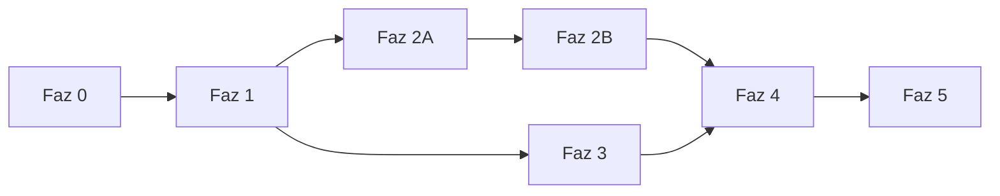

# Uygulama Fazları — Rehber ve İlerleme

Bu klasör, [TEKNIK_MIMARI_V2.md](../TEKNIK_MIMARI_V2.md)'deki mimarinin hangi sırayla ve nasıl kodlanacağını tanımlar. Kod, AI kodlama ajanı (Codex) tarafından **iş paketi (İP)** birimleriyle yazılır. Kalıcı kurallar kökteki [AGENTS.md](../AGENTS.md) dosyasındadır.

## 1. Fazlar

| Faz | Belge | Amaç | Kim |
| --- | --- | --- | --- |
| 0 | [FAZ-0-hazirlik.md](FAZ-0-hazirlik.md) | Kararlar, araçlar, depo, sunucu ve içerik girdileri | Kullanıcı |
| 1 | [FAZ-1-statik-site.md](FAZ-1-statik-site.md) | Astro sitesi, içerik şemaları, testler, deployctl, CI/CD, ilk dağıtım | Codex + kullanıcı (sunucu) |
| 2A | [FAZ-2A-indeksleyici.md](FAZ-2A-indeksleyici.md) | Content export, Türkçe arama motoru, site-indexer | Codex |
| 2B | [FAZ-2B-arama-api.md](FAZ-2B-arama-api.md) | site-api, arama endpoint'i, arama adası, mavi/yeşil geçiş | Codex + kullanıcı (sunucu) |
| 3 | [FAZ-3-tasarim-hareket.md](FAZ-3-tasarim-hareket.md) | Dennis yönündeki tasarım, intro, sayfa geçişleri, portre akışı | Codex + kullanıcı (onaylar) |
| 4 | [FAZ-4-asistan.md](FAZ-4-asistan.md) | Yerel model, bağlam planlayıcı, SSE, asistan adası, değerlendirme | Codex + kullanıcı (sunucu, model) |
| 5 | [FAZ-5-sertlestirme.md](FAZ-5-sertlestirme.md) | CSP, izleme, gizlilik, yük testi, tatbikatlar, lansman | Codex + kullanıcı |



- Faz 2A–2B ile Faz 3 paralel yürüyebilir. Aynı anda iki ajan çalıştırılacaksa ayrı branch'lerde çalışılır ve ortak dosyalar (`BaseLayout.astro`, `tokens.css`, `justfile`) için birleştirme sırasında dikkat edilir.
- Her fazın çıkışında iki kapı vardır: **kod kapısı** (yerelde ve CI'da doğrulanabilen her şey) ve **sunucu kapısı** (gerçek sunucuda yapılan adımlar). Sonraki fazın kod İP'leri yalnız kod kapısını bekler; sunucu İP'leri sunucu kapısını bekler. Böylece sunucu hazır olmasa da kod ilerler. Önkoşul sütunu hangi kapının gerektiğini belirtir.

## 2. Bir İP nasıl yürütülür

1. Kullanıcı Codex'e aşağıdaki istemi verir.
2. Codex İP'yi uygular, `just check` çalıştırır, ilerleme tablosunu günceller, commit hazırlar ve raporlar.
3. Kullanıcı inceleme listesini uygular, gerekirse düzeltme ister, sonra push eder.
4. Bir fazın İP'leri bitince faz belgesinin sonundaki **kod kapısı** ve (sunucu varsa) **sunucu kapısı** kontrol edilir. Gereken kapı geçilmeden bağımlı İP'ye geçilmez.
5. "Kullanıcı kontrolü" diye işaretli bitti ölçütleri (PR'da CI'ın yeşil olması, sunucuda yapılan adımlar) ajan tarafından değil kullanıcı tarafından işaretlenir; ajan bunları raporda "kullanıcıya bırakıldı" olarak listeler.

### 2.1 İstem şablonu

```text
AGENTS.md dosyasını ve fazlar/FAZ-<n>-<ad>.md dosyasını oku.
Yalnız İP-<x.y>'yi uygula. Önkoşulları kontrol et; eksikse başlama ve bildir.
İP'deki referans bölümleri (TEKNIK_MIMARI_V2.md) oku.
Bitince `just check` ve İP'nin istediği diğer doğrulamaları çalıştır.
fazlar/README.md ilerleme tablosunu güncelle, tek commit hazırla, push yapma.
AGENTS.md §3'teki rapor biçimiyle raporla.
Ürün/tasarım/güvenlik kararı gerektiren belirsizlikte dur ve sor.
```

Düzeltme istemi:

```text
İP-<x.y> raporundaki şu sorunları düzelt: <liste>. Kapsamı genişletme.
Yeniden `just check` çalıştır ve raporu güncelle.
```

### 2.2 Kullanıcının her İP sonrası inceleme listesi

- [ ] Rapordaki bitti ölçütlerinin hepsi ✓ mi? ✗ olanların gerekçesi kabul edilebilir mi?
- [ ] `git diff --stat`: İP'nin kapsamı dışında dosya değişmiş mi?
- [ ] Yeni bağımlılık eklendiyse AGENTS.md §9 listesinde mi?
- [ ] `just check` kendi makinende de geçiyor mu?
- [ ] İP "Elle kontrol" maddesi içeriyorsa tarayıcıda baktın mı?
- [ ] `// VARSAYIM:` işaretli yerler kabul edilebilir mi?
- [ ] Sonra: commit'i push et.

## 3. İlerleme tablosu

Durum değerleri: `Bekliyor`, `Sürüyor`, `Tamam`, `Engellendi`, `Ertelendi`. Codex her İP sonunda kendi satırını günceller.

### Faz 0 — Hazırlık (kullanıcı)

| İP | Başlık | Durum | Not |
| --- | --- | --- | --- |
| 0.1 | Temel kararların onayı | Bekliyor | |
| 0.2 | Geliştirme makinesi kurulumu | Bekliyor | |
| 0.3 | Git deposu ve GitHub | Bekliyor | |
| 0.4 | Sunucu bilgileri (A-01) | Bekliyor | Faz 1 dağıtım İP'leri ve Faz 4 için |
| 0.5 | Alan adı ve DNS (A-04) | Bekliyor | İP-1.13 için |
| 0.6 | İçerik ve portre hazırlığı | Bekliyor | Lansman için; yer tutucuyla başlanabilir |
| 0.7 | Tasarım tercihleri (A-07…A-12) | Bekliyor | Faz 3 için |

### Faz 1 — Statik site

| İP | Başlık | Önkoşul | Durum |
| --- | --- | --- | --- |
| 1.1 | Depo iskeleti ve araç zinciri | 0.1–0.3 | Bekliyor |
| 1.2 | Astro uygulaması ve kalite araçları | 1.1 | Bekliyor |
| 1.3 | İçerik şemaları, doğrulama ve örnek içerik | 1.2 | Bekliyor |
| 1.4 | Sayfa iskeleti, rotalar ve düzen bileşenleri | 1.3 | Bekliyor |
| 1.5 | Temel stil katmanı ve token'lar | 1.4 | Bekliyor |
| 1.6 | SEO ve site kipi (prelaunch/public) | 1.4 | Bekliyor |
| 1.7 | Caddy yapılandırması ve frontend testleri | 1.5, 1.6 | Bekliyor |
| 1.8 | deployctl: workspace, paket, durum, kilit, varlık deposu | 1.1 | Bekliyor |
| 1.9 | deployctl: Caddy geçişi, duman testi, geri dönüş | 1.7, 1.8 | Bekliyor |
| 1.10 | Sürüm paketi: `just release` | 1.9 | Bekliyor |
| 1.11 | Sunucu kurulum betikleri ve runbook | 1.9 | Bekliyor |
| 1.12 | CI kalite iş akışı | 1.7, 1.10, 1.11 | Bekliyor |
| 1.13 | CD iş akışı ve ilk dağıtım | 1.11, 1.12, 0.4, 0.5 | Bekliyor |

### Faz 2A — İndeksleyici

| İP | Başlık | Önkoşul | Durum |
| --- | --- | --- | --- |
| 2A.1 | Content export v1 (Astro) | Faz 1 kod kapısı | Bekliyor |
| 2A.2 | Rust workspace ve `contract` crate'i | 2A.1 | Bekliyor |
| 2A.3 | Türkçe metin işleme ve etiket eşleştirici | 2A.2 | Bekliyor |
| 2A.4 | Bölme ve bundle modeli | 2A.3 | Bekliyor |
| 2A.5 | Tantivy indeks şeması ve kurucu | 2A.4 | Bekliyor |
| 2A.6 | Sorgu motoru | 2A.5 | Bekliyor |
| 2A.7 | `site-indexer` CLI | 2A.6 | Bekliyor |
| 2A.8 | Altın testler ve `site-eval search` | 2A.7 | Bekliyor |
| 2A.9 | CI ve sürüm paketine bundle | 2A.8 | Bekliyor |

### Faz 2B — Arama API'si

| İP | Başlık | Önkoşul | Durum |
| --- | --- | --- | --- |
| 2B.1 | `site-api` iskeleti | Faz 2A kod kapısı | Bekliyor |
| 2B.2 | Arama endpoint'i ve hız sınırı | 2B.1 | Bekliyor |
| 2B.3 | TS tip üretimi ve API istemcisi | 2B.2 | Bekliyor |
| 2B.4 | Geliştirme ortamı: `just dev` | 2B.3 | Bekliyor |
| 2B.5 | Arama adası ve `/ara` sayfası | 2B.4 | Bekliyor |
| 2B.6 | Sürüm hattına API ve mavi/yeşil geçiş | 2B.1, 1.9 | Bekliyor |
| 2B.7 | Sunucu: systemd şablonu, sudoers, bootstrap güncellemesi | 2B.6 (sunucu adımı: Faz 1 sunucu kapısı) | Bekliyor |
| 2B.8 | Uçtan uca testler ve CI | 2B.5, 2B.7 | Bekliyor |

### Faz 3 — Tasarım ve hareket

| İP | Başlık | Önkoşul | Durum |
| --- | --- | --- | --- |
| 3.1 | Tasarım token'ları ve tipografi | Faz 1 kod kapısı, 0.7 | Bekliyor |
| 3.2 | Üst bölüm: gezinme ve arama alanı | 3.1, 2B.5 | Bekliyor |
| 3.3 | Ana sayfa hero kompozisyonu | 3.2 | Bekliyor |
| 3.4 | Proje satırları ve proje listesi | 3.1 | Bekliyor |
| 3.5 | Proje detayı, Hakkımda, alt bilgi, 404 | 3.4, 2B.5 | Bekliyor |
| 3.6 | Çok dilli intro ve emniyet | 3.3 | Bekliyor |
| 3.7 | Sayfa geçişleri | 3.5 | Bekliyor |
| 3.8 | Hero akışı prototipleri ve ölçüm | 3.3 | Bekliyor |
| 3.9 | Hero akışı üretim sürümü | 3.8 (+ A-03 kararı) | Bekliyor |
| 3.10 | Mobil, erişilebilirlik ve performans | 3.6, 3.7, 3.9 | Bekliyor |

### Faz 4 — Asistan

| İP | Başlık | Önkoşul | Durum |
| --- | --- | --- | --- |
| 4.1 | Model sunucusu kurulumu ve ölçüm araçları | Faz 2B kod kapısı (kullanıcı adımları: Faz 2B sunucu kapısı, 0.4) | Bekliyor |
| 4.2 | `assistant` crate'i ve bağlam kartı | Faz 2B kod kapısı | Bekliyor |
| 4.3 | Bağlam planlayıcı, sistem talimatı, atıf | 4.2 | Bekliyor |
| 4.4 | Model istemcisi ve sağlık izleme | 4.3 | Bekliyor |
| 4.5 | Asistan endpoint'leri | 4.4 | Bekliyor |
| 4.6 | Asistan adası | 4.5, Faz 3 kapısı | Bekliyor |
| 4.7 | Değerlendirme araçları, soru seti ve geri getirme ölçümü | 4.5 | Bekliyor |
| 4.8 | Sunucu kurulumu ve uçtan uca iptal testi | 4.1, 4.5, Faz 2B sunucu kapısı | Bekliyor |
| 4.9 | Model seçimi ve üretim değerlendirmesi | 4.7, 4.8 | Bekliyor |

### Faz 5 — Sertleştirme ve lansman

| İP | Başlık | Önkoşul | Durum |
| --- | --- | --- | --- |
| 5.1 | CSP ve güvenlik başlıkları | Faz 4 kod ve sunucu kapıları | Bekliyor |
| 5.2 | İzleme, uyarılar, log saklama | Faz 4 kod ve sunucu kapıları | Bekliyor |
| 5.3 | Gizlilik sayfası | Faz 4 kod ve sunucu kapıları | Bekliyor |
| 5.4 | Yük testleri | 5.2 | Bekliyor |
| 5.5 | Runbook ve tatbikatlar | 5.2 | Bekliyor |
| 5.6 | Lansman | 5.1–5.5 | Bekliyor |
| 5.7 | (İsteğe bağlı) Canlı demo altyapısı | İlk demo | Bekliyor |
| 5.8 | (İsteğe bağlı) Proje başına OG görseli | Faz 3 kapısı | Bekliyor |

## 4. Fazlar boyunca geçerli ilkeler

- **Her İP sonunda çalışan bir sistem.** Yarım bırakılan özellik ana dala girmez; gerekirse özellik bayrağıyla kapalı tutulur.
- **Önce test edilebilir çekirdek, sonra kenar.** Saf fonksiyonlar (normalize, planlayıcı, durum makinesi) önce yazılır ve test edilir; I/O katmanı sonra eklenir.
- **Yer tutucu içerikle ilerle.** Gerçek içerik beklenmez; `placeholder: true` ile işaretli örnekler kullanılır. Lansman kapısı yer tutucuyu yasaklar.
- **Ölçülmeyen performans iddiası yok.** Bütçeler Lighthouse CI ve `site-eval` ile ölçülür.
- **Karar kaydı.** Önemli bir tercih yapıldığında `docs/adr/` altına kısa ADR eklenir. Numaralar paralel fazlarda çakışmasın diye önceden ayrılmıştır:

  | No | Konu | İP |
  | --- | --- | --- |
  | 0001–0008 | V2 §2.2 kararları | 1.1 |
  | 0009 | Hero akış tekniği | 3.8 |
  | 0010 | Model, runtime ve prompt sürümü | 4.1, 4.9 |
  | 0011 | CSP | 5.1 |
  | 0012 | Asistan sınır değerleri | 5.4 |
  | 0013+ | Sonraki kararlar (sırayla) | — |
